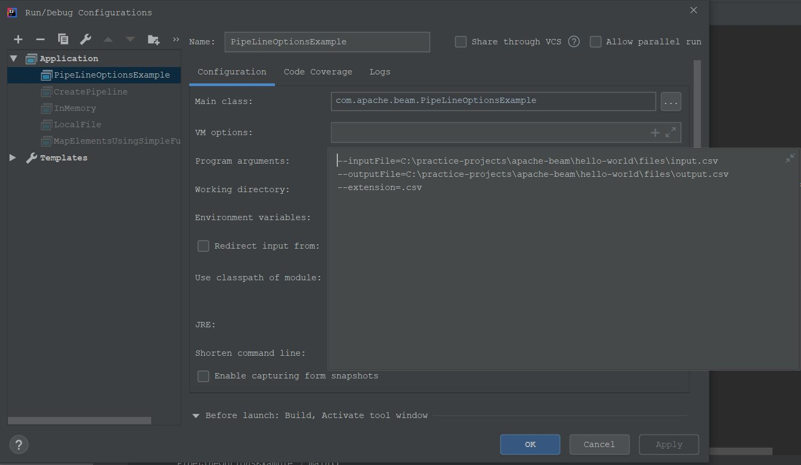

# Apache Beam Hello World

Maven project of small DirectRunner pipelines. Beam `2.19.0`, Java 11. Each example class has its own `main` method.

Input CSVs live in [`files`](files). Most classes read and write through a hardcoded Windows path (`C:\practice-projects\apache-beam\hello-world\files\`). [`Constants`](src/main/java/com/apache/beam/Constants.java) holds that path for the later examples. Point those paths at this `files` folder before running.

`TextIO.write().to(...).withNumShards(1).withSuffix(".csv")` does not create `output.csv`. The file name is `output.csv-00000-of-00001.csv` in the same folder.

## Examples

* [Create a pipeline](src/main/java/com/apache/beam/CreatePipeline.java) — `Pipeline.create()` and print the pipeline object. No transforms and no `run()`.
* [Read and write a local file](src/main/java/com/apache/beam/LocalFile.java) — `TextIO` reads `returns.csv` and writes it back out.
* [Print elements in a PCollection](src/main/java/com/apache/beam/PrintElementsInPCollection.java) — `ParDo` prints each row of `customers.csv`.
* [In-memory source](src/main/java/com/apache/beam/InMemory.java) — `Create.of` builds a `PCollection<Customer>`, maps each name to upper case, and writes the names.
* [Pipeline options](src/main/java/com/apache/beam/PipeLineOptionsExample.java) — input file, output file, and suffix come from [`MyPipelineOptions`](src/main/java/com/apache/beam/MyPipelineOptions.java).

  Program arguments:

  ```text
  --inputFile=C:\practice-projects\apache-beam\hello-world\files\input.csv
  --outputFile=C:\practice-projects\apache-beam\hello-world\files\output.csv
  --extension=.csv
  ```

  
* [MapElements with SimpleFunction](src/main/java/com/apache/beam/MapElementsUsingSimpleFunction.java) — upper-cases each line of `input.csv` and appends `-test`.
* [ParDo](src/main/java/com/apache/beam/ParDoExample.java) — keeps `input.csv` rows whose name starts with `a`.
* [Filter](src/main/java/com/apache/beam/FilterExample.java) — same name filter, using `Filter.by` instead of `ParDo`.
* [Flatten](src/main/java/com/apache/beam/FlattenExample.java) — merges `input.csv`, `input2.csv`, and `input3.csv` into one `PCollection`.
* [Partition](src/main/java/com/apache/beam/PartitionExample.java) — splits `input.csv` into three partitions by the first letter of the name (`j`, `a`, everything else). The pipeline is built and not run.
* [Side inputs](src/main/java/com/apache/beam/SideInputExample.java) — `returns.csv` is a `View.asMap()` side input. Prints `customers.csv` rows whose id is not in that map.
* [Distinct](src/main/java/com/apache/beam/DistinctExample.java) — drops duplicate rows from `customers.csv`.
* [Count](src/main/java/com/apache/beam/CountPCollection.java) — `Count.globally()` on `customers.csv` and prints the count.
* [GroupByKey](src/main/java/com/apache/beam/GroupByKeyExample.java) — groups `customer-orders.csv` by customer id and writes the sum of `amount`.
* [Fixed windows](src/main/java/com/apache/beam/windowing/WindowingExample1.java) — assigns `input4.csv` to fixed windows of 1 second. No further transform writes the windowed data.

## Run

Run the `main` method of an example class from the IDE. [`pom.xml`](pom.xml) compiles with Java 11 and does not declare an exec plugin. Update the hardcoded file paths first.
