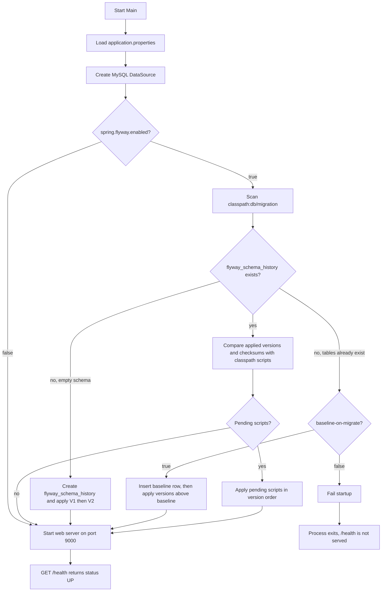
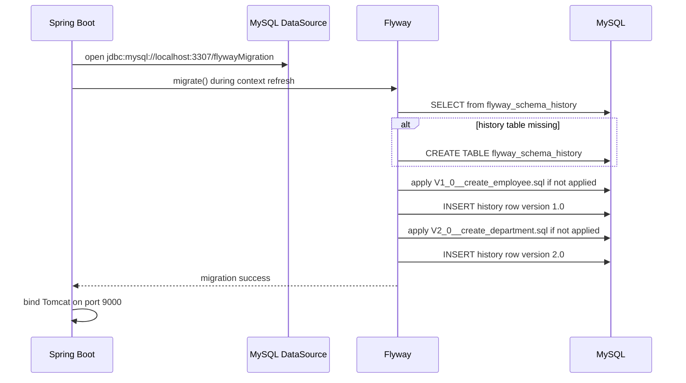
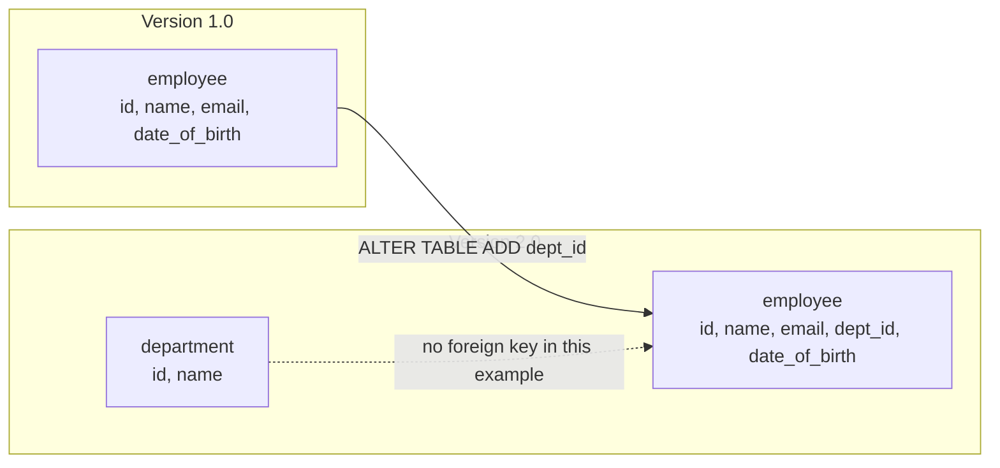

# Spring Boot Flyway Basic Example

A minimal Spring Boot application that uses [Flyway](https://documentation.red-gate.com/flyway) to create and evolve a MySQL schema at startup. There is no JPA layer and no business API. The point of the project is the migration itself: when the application starts, Flyway applies ordered SQL scripts, records what it applied, and only then does the web server accept traffic.

| Item | Value |
| --- | --- |
| Spring Boot | 4.1.1 |
| Java | 21 |
| Database | MySQL (`localhost:3307`, database `flywayMigration`) |
| HTTP port | `9000` |
| Health check | `GET /health` |

---

## Problem statement

Application code and the database schema drift apart when schema changes are applied by hand.

Typical symptoms:

- A developer creates `employee` on a local MySQL instance, another developer creates it with a slightly different column list, and neither change is in source control.
- A later change (add `dept_id`) is run on one environment and forgotten on another.
- There is no record of which scripts already ran, so re-running a `CREATE TABLE` either fails or, with `IF NOT EXISTS`, silently skips a script that was edited after it first ran.
- Startup succeeds even when the schema is wrong, and the failure shows up later as a SQL exception in application code.

This example treats the schema as versioned source code. Two scripts live under `src/main/resources/db/migration`. Flyway runs them in version order the first time the process starts, writes a row per script into `flyway_schema_history`, and on every later start compares that table with the files on the classpath. Pending scripts run. Scripts that already ran are left alone. A script whose contents changed after it was applied fails the build-up of the application instead of drifting silently.

The domain used to show that is small on purpose:

1. Version `1.0` creates `employee`.
2. Version `2.0` creates `department` and adds `employee.dept_id`.

`GET /health` only proves the process finished startup. If a migration fails, Spring Boot aborts before that endpoint is available.

---

## What you get after a successful start

```text
flywayMigration
├── employee                  created by V1, altered by V2
├── department                created by V2
└── flyway_schema_history     created and maintained by Flyway
```

`employee` columns: `id`, `name`, `email`, `dept_id`, `date_of_birth`.

`department` columns: `id`, `name`.

`dept_id` is a plain `int`. This example does not add a foreign key.

---

## Project layout

```text
spring-boot-flyway
├── pom.xml
├── sql/mysql-queries.sql                          local MySQL setup and inspection queries
└── src/main
    ├── java/com/practice
    │   ├── Main.java                              Spring Boot entry point
    │   └── controller/HealthController.java       GET /health
    └── resources
        ├── application.properties                 datasource and Flyway settings
        └── db/migration
            ├── V1_0__create_employee.sql
            └── V2_0__create_department.sql
```

`Main` is a standard `@SpringBootApplication`. It does not call Flyway directly. `spring-boot-starter-flyway` registers a `FlywayMigrationInitializer` that runs during application context refresh, before the embedded web server is ready.

---

## How a start-up works



Second and later starts take the right-hand branch: history already exists, both versions are recorded, nothing is re-executed, and the web server starts.



---

## Implementation steps

### 1. Dependencies

`pom.xml` uses Spring Boot parent `4.1.1` and Java 21. Four dependencies do the migration work:

| Dependency | Role |
| --- | --- |
| `spring-boot-starter-web` | Embedded web server and `GET /health`. |
| `spring-boot-starter-flyway` | Auto-configures Flyway and runs migrations on startup. |
| `flyway-mysql` | MySQL support for the Flyway version used by Spring Boot. Required in addition to the starter. |
| `mysql-connector-j` | JDBC driver. Scope is `runtime`. |
| `spring-boot-starter-flyway-test` | Test-scoped Flyway support. This project has no test sources yet. |

`spring-boot-starter-jdbc` is not declared directly. The Flyway starter brings a JDBC `DataSource` auto-configuration, which is enough for migrations and is all this example needs.

### 2. MySQL database and user

The app expects MySQL already listening on **port 3307** (not the MySQL default `3306`). Create the database and login before the first start. From `sql/mysql-queries.sql`:

```sql
create database if not exists flywaymigration;
create user 'user1'@'localhost' identified by 'Password1';
grant all on flywaymigration.* to 'user1'@'localhost';
```

The checked-in script grants to `'username'@'localhost'` on that line. The datasource user is `user1`, so the grant target has to be `'user1'@'localhost'` or authentication fails.

`grant super on *.*` is also in that script. This example's DDL (`CREATE TABLE`, `ALTER TABLE`) does not need the `SUPER` privilege. `ALL` on `flywaymigration.*` is the privilege that matters.

On Windows, MySQL usually treats database names as case-insensitive, so `flywaymigration` and the URL's `flywayMigration` refer to the same schema. On a case-sensitive server, create the database with the exact name used in `spring.datasource.url`.

### 3. Datasource and Flyway properties

All runtime configuration is in `src/main/resources/application.properties`. Each property is explained in the next section. No YAML, profile, or Java `@Bean` overrides these values.

### 4. Versioned SQL scripts

Place scripts in `src/main/resources/db/migration`. Flyway discovers them because `spring.flyway.locations=classpath:db/migration`.

File name pattern:

```text
V<version>__<description>.sql
```

- Prefix `V` marks a versioned migration (as opposed to repeatable `R` or undo `U` scripts, which this project does not use).
- Version separators may be `_` or `.`. `V1_0` is version **1.0**. `V2_0` is version **2.0**.
- Two underscores separate the version from the description. One underscore is not enough.
- The description is recorded in `flyway_schema_history.description` after underscores are turned into spaces (`create employee`, `create department`).
- Versions sort numerically, not alphabetically: `1.0` runs before `2.0`.

`V1_0__create_employee.sql` creates `employee`. `V2_0__create_department.sql` creates `department` and then adds `dept_id` to `employee`. Both statements use `CREATE TABLE IF NOT EXISTS`, so a partially prepared database does not fail on the create. The `ALTER TABLE` does not, so that statement can only succeed once.

### 5. Run

From the project root, with MySQL up and the database created:

```bash
mvn spring-boot:run
```

On success the log contains Flyway's migration summary (versions `1.0` and `2.0` on a fresh database) and the application listens on port `9000`.

Check the process:

```bash
curl http://localhost:9000/health
```

```json
{"status":"UP"}
```

Check the schema:

```sql
use flywaymigration;
select * from flyway_schema_history;
select * from employee;
select * from department;
```

A fresh run inserts history rows similar to:

| installed_rank | version | description | type | script | success |
| --- | --- | --- | --- | --- | --- |
| 1 | 1.0 | create employee | SQL | V1_0__create_employee.sql | 1 |
| 2 | 2.0 | create department | SQL | V2_0__create_department.sql | 1 |

If `baseline-on-migrate` baselined an existing non-empty schema first, rank 1 is a `BASELINE` row with version `1` and no script, and only migrations **above** version 1 run. See the property section below.

### 6. Later starts

Start the application again without deleting tables. Flyway reads `flyway_schema_history`, sees versions `1.0` and `2.0` as already successful, validates each file's checksum, and does not execute the SQL again. `/health` still returns `UP`.

To watch a migration fail closed, edit `V1_0__create_employee.sql` after it has been applied and restart. Flyway detects the checksum mismatch and aborts startup. Restore the file or repair history before the app can start. Do not edit a migration that has already shipped; add `V3_0__...sql` instead.

### 7. Reset the local schema

`sql/mysql-queries.sql` drops the tables Flyway created:

```sql
drop table employee;
drop table department;
drop table flyway_schema_history;
```

The next start treats the database as new and applies both scripts again. Dropping only the application tables and leaving `flyway_schema_history` makes Flyway believe the scripts already ran, so the tables are not recreated.

---

## Configuration properties

Everything below is the full `application.properties` in this project.

### `spring.application.name=spring-boot-flyway`

Logical name of the application. Spring Boot uses it in logs and as the default name reported by the runtime. It is not sent to MySQL and it does not affect which migration scripts run.

### `server.port=9000`

Port of the embedded web server. `9000` avoids clashing with another app on the usual `8080`. This value is unrelated to MySQL. The database port is inside `spring.datasource.url`.

`GET /health` is served only after migrations succeed. A Flyway failure means nothing is listening on `9000`.

### `spring.datasource.url=jdbc:mysql://localhost:3307/flywayMigration`

JDBC URL of the schema Flyway migrates.

| Piece | Meaning in this example |
| --- | --- |
| `jdbc:mysql://` | MySQL Connector/J protocol. |
| `localhost` | MySQL runs on the same machine as the app. |
| `3307` | Server port. This is intentionally not `3306`. If MySQL listens on `3306`, either change this URL or start MySQL on `3307`. |
| `flywayMigration` | Database name. It must already exist. Flyway migrates objects inside a database; it does not create the database itself. |

The URL has no extra query parameters (`useSSL`, `serverTimezone`, and so on). Connector/J defaults apply.

### `spring.datasource.username=user1`

MySQL account Flyway uses for the connection. The account needs rights to create and alter tables in `flywayMigration`, and to create `flyway_schema_history` on first run.

### `spring.datasource.password=Password1`

Password for `user1`. These values match `sql/mysql-queries.sql` and are for a local demo only. Do not reuse them outside this example.

### `spring.datasource.driver-class-name=com.mysql.cj.jdbc.Driver`

Fully qualified JDBC driver class. `mysql-connector-j` registers this driver. Spring Boot can infer it from a `jdbc:mysql:` URL, so the line is explicit rather than required. If the driver jar is missing, startup fails before Flyway runs.

### `spring.flyway.enabled=true`

Turns Flyway auto-configuration on. `true` is the default when `spring-boot-starter-flyway` is on the classpath, so the line documents intent.

Set it to `false` to boot the web app without migrating. Existing tables stay as they are, pending scripts are not applied, and `/health` can return `UP` against a stale schema. Leave it `true` for this example.

### `spring.flyway.locations=classpath:db/migration`

Where Flyway loads migrations from. `classpath:` means resources packaged inside the jar (here, `src/main/resources/db/migration`).

The default location is already `classpath:db/migration`. Setting it makes the folder contract obvious: a script placed anywhere else is ignored, and renaming the folder without updating this property makes Flyway see zero migrations.

Multiple locations are comma-separated. This project uses one.

### `spring.flyway.baseline-on-migrate=true`

Controls the first run against a database that **already has objects** but has **no** `flyway_schema_history` table.

Flyway's normal rule: a non-empty schema without history is not a migration target, and startup fails. That protects you from applying `V1` on a database someone already built by hand.

`baseline-on-migrate=true` changes that first encounter:

1. Flyway creates `flyway_schema_history`.
2. It inserts a baseline marker at version `1` (the default of `spring.flyway.baseline-version`, which this project does not override).
3. It then migrates only versions **strictly greater than** the baseline.

Consequences for **this** pair of scripts:

| Database state before first start | What Flyway does |
| --- | --- |
| Empty database (no user tables, no history) | No baseline. Applies `1.0`, then `2.0`. This is the path you want. |
| Non-empty database, no history | Baselines at version `1`. Version `1.0` is **not** greater than `1`, so `V1_0__create_employee.sql` is skipped. Version `2.0` is applied. |
| History table already present | Baseline is not considered. Pending versions above the latest applied version run as usual. |

The default of `baseline-on-migrate` is `false`. This project sets `true` so an existing database can be brought under version control without dropping its data. Prefer an empty `flywayMigration` database when you want both scripts to run.

Related properties this file does **not** set, and the defaults that therefore apply:

| Property | Default used here | Effect |
| --- | --- | --- |
| `spring.flyway.baseline-version` | `1` | Baseline marker version when baselining. |
| `spring.flyway.baseline-description` | `<< Flyway Baseline >>` | Description stored on the baseline row. |
| `spring.flyway.schemas` | schema implied by the JDBC URL | Flyway migrates `flywayMigration` only. |
| `spring.flyway.table` | `flyway_schema_history` | Name of the bookkeeping table. |
| `spring.flyway.validate-on-migrate` | `true` | Checksum and description of applied scripts are checked on every start. |
| `spring.flyway.clean-disabled` | `true` | `clean` (drop all objects) cannot run. Leave this alone. |
| `spring.flyway.out-of-order` | `false` | A script older than the current version is rejected, not applied late. |

---

## Migration scripts

### V1.0 — `employee`

```sql
CREATE TABLE IF NOT EXISTS employee (
    id int NOT NULL AUTO_INCREMENT PRIMARY KEY,
    name varchar(20),
    email varchar(50),
    date_of_birth timestamp
);
```

`id` is the primary key, assigned by MySQL. `name`, `email`, and `date_of_birth` are nullable because the column definitions do not say `NOT NULL`.

### V2.0 — `department` and `employee.dept_id`

```sql
CREATE TABLE IF NOT EXISTS `department` (
    id int NOT NULL AUTO_INCREMENT PRIMARY KEY,
    name varchar(20)
);

ALTER TABLE `employee` ADD dept_id int AFTER email;
```

The script is one migration. Flyway runs it in a transaction where the engine allows it. Both statements succeed or the version is not marked successful.

`AFTER email` places `dept_id` between `email` and `date_of_birth`. The final `employee` column order is `id`, `name`, `email`, `dept_id`, `date_of_birth`.

There is no `FOREIGN KEY (dept_id) REFERENCES department(id)` and no index on `dept_id`. A later version (for example `V3_0__add_employee_department_fk.sql`) would be the Flyway way to add that. Changing `V2` after it has been applied breaks checksum validation.



---

## `flyway_schema_history`

Flyway creates this table in the same database. Application code never reads it. Columns you will use while learning the example:

| Column | Meaning |
| --- | --- |
| `installed_rank` | Order in which rows were inserted, starting at 1. |
| `version` | Script version, such as `1.0`, or `1` for a baseline. |
| `description` | Text taken from the file name. |
| `type` | `SQL` for these files, `BASELINE` if baselining ran. |
| `script` | File name, or `<< Flyway Baseline >>` for a baseline row. |
| `checksum` | CRC32 of the file contents at apply time. A later edit no longer matches. |
| `installed_by` | MySQL user that ran the migration (`user1`). |
| `installed_on` | When the row was written. |
| `execution_time` | Milliseconds the script took. |
| `success` | `1` when the script finished. A `0` blocks later migrations until the failed row is removed or repaired. |

---

## Failure cases

| Symptom | Likely cause |
| --- | --- |
| Connection refused on `localhost:3307` | MySQL is down or listening on another port. Align the server with `spring.datasource.url`. |
| Unknown database `flywayMigration` | The `CREATE DATABASE` step was skipped. Flyway does not create databases. |
| Access denied for `user1` | User or password does not match, or the grant targeted `'username'` instead of `'user1'`. |
| Found non-empty schema `flywayMigration` without schema history | `baseline-on-migrate` is `false` while tables already exist. This project sets it `true`, so this appears only if that line is removed. |
| Migration checksum mismatch | A script under `db/migration` changed after it was applied. Restore the original file or add a new version. |
| `Duplicate column name 'dept_id'` | `V2` ran when `employee.dept_id` already existed (history was dropped, or the column was added by hand) while the history row for `2.0` was not present. |
| `/health` works but `employee` is missing | Baselining skipped `1.0` because the schema was already non-empty. Drop the schema objects, including `flyway_schema_history`, and start again on an empty database. |
| Port `9000` already in use | Another process holds `server.port`. Migrations may already have committed before the web server fails. |

---

## Scope of this example

Included: classpath versioned migrations, MySQL, baseline-on-migrate, and a health endpoint that becomes available only after migrate succeeds.

Not included: JPA entities, repositories, repeatable migrations, callbacks, Java-based migrations, multiple schemas, or profile-specific locations. Add those as new `V3_...` scripts and, when needed, new properties, rather than rewriting `V1` or `V2`.
