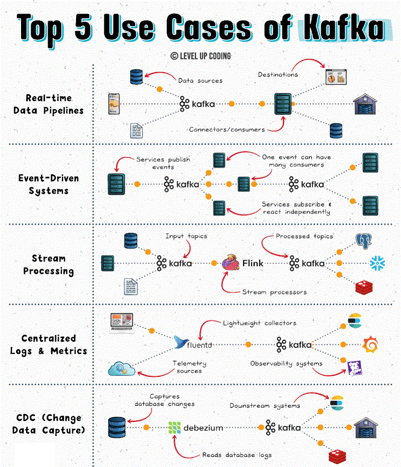

Top 5 Kafka Use Cases

Kafka is often described as a queue, but it’s really a system for streaming and reacting to data.

- 𝗥𝗲𝗮𝗹-𝘁𝗶𝗺𝗲 𝗱𝗮𝘁𝗮 𝗽𝗶𝗽𝗲𝗹𝗶𝗻𝗲𝘀
Kafka continuously moves data between systems as it’s generated. Instead of batch jobs, data flows in real time from apps to warehouses, analytics systems, 
or downstream services.

- 𝗘𝘃𝗲𝗻𝘁-𝗱𝗿𝗶𝘃𝗲𝗻 𝘀𝘆𝘀𝘁𝗲𝗺𝘀
Services publish events (like orders or user actions), and other services react instantly. This decouples systems and makes architectures more scalable and flexible.

- 𝗦𝘁𝗿𝗲𝗮𝗺 𝗽𝗿𝗼𝗰𝗲𝘀𝘀𝗶𝗻𝗴
Kafka enables real-time transformations: filtering, enriching, or aggregating data as it flows. You don’t wait for storage; you process data in motion.

- 𝗖𝗲𝗻𝘁𝗿𝗮𝗹𝗶𝘇𝗲𝗱 𝗹𝗼𝗴𝘀 𝗮𝗻𝗱 𝗺𝗲𝘁𝗿𝗶𝗰𝘀
Kafka aggregates logs and metrics from distributed services into one pipeline. This makes monitoring, debugging, and observability far easier at scale.

- 𝗖𝗵𝗮𝗻𝗴𝗲 𝗱𝗮𝘁𝗮 𝗰𝗮𝗽𝘁𝘂𝗿𝗲 (𝗖𝗗𝗖)
Commonly used to stream database changes as they happen. Instead of polling or syncing manually, systems stay updated in real time with minimal overhead.

---
Kafka’s real strength is handling high-throughput, real-time data at scale without tight coupling between systems. It enables systems to move, react to, and process data in real time.
---
