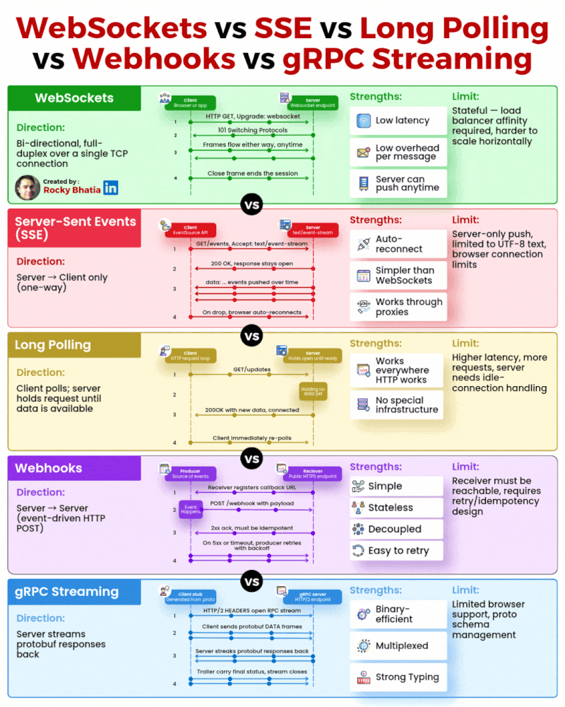

- 𝗪𝗲𝗯𝗦𝗼𝗰𝗸𝗲𝘁𝘀 — 𝗧𝗵𝗲 𝗧𝘄𝗼-𝗪𝗮𝘆 𝗦𝘁𝗿𝗲𝗲𝘁
Both sides talk. Both sides listen. Lightning fast.
✅ Crush it: Chat apps, multiplayer games, live trading floors
⚠️ Pain: Stateful chaos when you scale

- 𝗦𝗦𝗘 — 𝗧𝗵𝗲 𝗦𝗶𝗹𝗲𝗻𝘁 𝗕𝗿𝗼𝗮𝗱𝗰𝗮𝘀𝘁𝗲𝗿
Server talks. Client listens. Auto-reconnects like magic.
✅ Crush it: Stock tickers, live notifications, news feeds
⚠️ Pain: One-way only, text-only

- 𝗟𝗼𝗻𝗴 𝗣𝗼𝗹𝗹𝗶𝗻𝗴 — 𝗧𝗵𝗲 𝗧𝗿𝘂𝘀𝘁𝘆 𝗕𝗮𝗰𝗸𝘂𝗽
The "works literally everywhere" protocol. Zero infrastructure changes.
✅ Crush it: Legacy systems, restrictive networks
⚠️ Pain: Higher latency, exhausted servers

- 𝗪𝗲𝗯𝗵𝗼𝗼𝗸𝘀 — 𝗧𝗵𝗲 𝗦𝗶𝗹𝗲𝗻𝘁 𝗠𝗲𝘀𝘀𝗲𝗻𝗴𝗲𝗿
Something happened. POST fires. Receiver acts. Done.
✅ Crush it: Stripe payments, GitHub triggers, third-party integrations
⚠️ Pain: Receiver downtime = lost events

- 𝗴𝗥𝗣𝗖 𝗦𝘁𝗿𝗲𝗮𝗺𝗶𝗻𝗴 — 𝗧𝗵𝗲 𝗦𝗽𝗲𝗲𝗱 𝗗𝗲𝗺𝗼𝗻
Binary, multiplexed, blazingly fast. The internal microservice MVP.
✅ Crush it: Microservices, internal APIs, data pipelines
⚠️ Pain: Browsers hate it

Quick Cheat Sheet:
Chat? → WebSockets
Feed? → SSE
Fallback? → Long Polling
Integration? → Webhooks

Microservices? → gRPC

---
