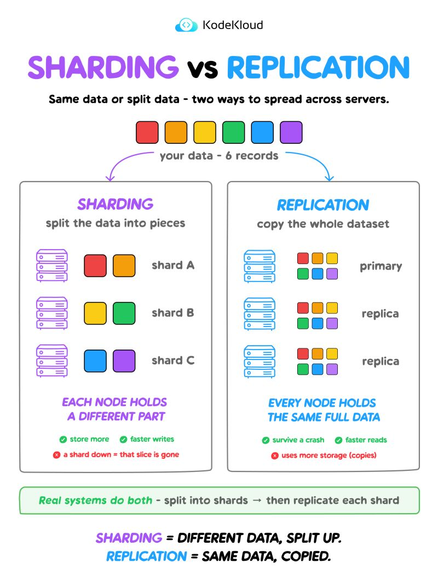

Sharding and replication both spread data across servers. They solve opposite problems.

Sharding = different data, split up.
Replication = same data, copied.

Sharding splits the dataset, each node holds a different slice. Replication copies it, every node holds the same full dataset.

That's the mental model. Three refinements worth carrying with it:

1️⃣ It's throughput, not latency.
 Sharding doesn't make a single write faster. It lets more writes happen at once, because they land on different nodes. Same with reads across replicas. Your p99 on one query won't drop. Your ceiling goes up. 📈

2️⃣ Replicas can lie to you.
 With async replication, a replica may be seconds behind the primary. Write to the primary, immediately read from a replica, and the row isn't there yet. ⚠️ This causes more production bugs than storage cost ever will. It's why "read your own writes" is a design decision, not a default.

3️⃣ Sharding's real pain isn't a node going down, it's the shard key.
 Pick badly and one shard takes 80% of the traffic while the rest idle. Queries that cross shards lose the joins and transactions you took for granted. 🔥

Which is why production systems run both: shard for capacity, replicate each shard for durability. Cassandra, MongoDB, Vitess, Kafka, all the same shape.

---
