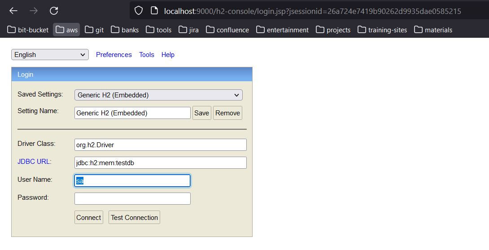

# Spring Batch Custom ItemReader

Spring Boot application that reads a text file with a custom `ItemReader`, passes each line through a processor, and logs the chunk. The job does not start on its own. A GET request launches it.

Spring Batch job metadata is stored in an embedded H2 database. The file lines are not written to a table.

## Prerequisites

- Java 8
- Maven 3.6+

## Run

```bash
mvn spring-boot:run
```

The HTTP server listens on port `9000`. `spring.batch.job.enabled` is `false`, so startup only creates the job beans and the H2 batch tables.

## Launch the job

`GET /` starts `csvReaderJob` with a `time` parameter set to the current time, so each request is a new job instance.

```bash
curl http://localhost:9000/
```

The response is the `BatchStatus` after the job finishes, usually `COMPLETED`.

Each of the 10 lines in [`file1.txt`](src/main/resources/file1.txt) is one item. The step chunk size is 100, so the writer runs once for the whole file.

The processor logs each line:

```text
ContentModel=ContentModel(content=...)
```

The writer logs the chunk:

```text
users=[ContentModel(content=...), ...]
```

## Job flow

1. [`AppController`](src/main/java/com/cerebro/controller/AppController.java) builds job parameters and calls `JobLauncher.run`.
2. [`AppConfig`](src/main/java/com/cerebro/config/AppConfig.java) defines one step, `csvFileLoad`, on the job `csvReaderJob`. The step uses a chunk of 100.
3. [`CustomItemReader`](src/main/java/com/cerebro/component/CustomItemReader.java) implements `ItemReader<ContentModel>`. Its constructor loads every line of the classpath file `file1.txt` into memory. `read()` returns the next `ContentModel`, then `null` when the list is exhausted. Returning `null` tells Spring Batch the input is finished. The reader then resets its index so the same bean can run again.
4. [`ContentProcessor`](src/main/java/com/cerebro/batch/ContentProcessor.java) logs the item and returns it unchanged.
5. [`ContentWriter`](src/main/java/com/cerebro/batch/ContentWriter.java) logs the chunk. It does not save the lines.

`ContentModel` has a single field, `content`.

The reader does not use `app.input`. That property is only referenced by `initializeV1()`, which is not called. The active path is `initializeV2()`, and it always opens `file1.txt` from the classpath. `AppConfig` also defines a `LineMapper` left over from a `FlatFileItemReader`; the job does not use it.

## Batch metadata

H2 is the job repository. Spring Boot creates the in-memory database and the Spring Batch tables on startup.

| Setting | Value |
| --- | --- |
| JDBC URL | `jdbc:h2:mem:testdb` |
| User | `sa` |
| Password | empty |

Queries for the job and step tables are in [`sqls/selects.sql`](sqls/selects.sql). The console login below uses that same database. `application.yml` does not set `spring.h2.console.enabled`, so `/h2-console` stays off unless that property is turned on.



The database is in memory. Tables disappear when the application stops.

## Configuration

Values in [`src/main/resources/application.yml`](src/main/resources/application.yml):

| Property | Value | Purpose |
| --- | --- | --- |
| `server.port` | `9000` | HTTP port |
| `spring.batch.job.enabled` | `false` | Do not run the job at startup |
| `app.input` | `file:src/main/resources/file1.txt` | Unused by the active reader |
| `logging.file` | `logs/app.log` | Log file |

## Layout

```text
src/main/java/com/cerebro
├── App.java                         Application entry point
├── config/AppConfig.java            Job and step
├── component/CustomItemReader.java  ItemReader that loads file1.txt
├── batch/ContentProcessor.java      Logs each line
├── batch/ContentWriter.java         Logs each chunk
├── controller/AppController.java    GET / launches the job
└── model/ContentModel.java          One file line
```

## References

* [Spring Batch Tutorial: Creating a Custom ItemReader](https://www.petrikainulainen.net/programming/spring-framework/spring-batch-tutorial-creating-a-custom-itemreader/)
