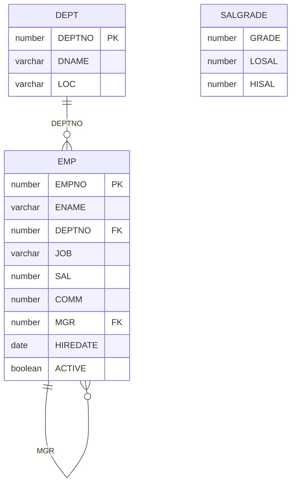

# Spring Data JPA Practice

A Spring Boot application that exercises Spring Data JPA against the classic employee schema (`EMP`, `DEPT`, `SALGRADE`) stored in a file-based H2 database. Each HTTP endpoint is one repository example: a derived query method, a JPQL or native `@Query`, a named query, a page, a custom fragment, or a CRUD call.

| Item | Value |
| --- | --- |
| Spring Boot | 1.3.1 |
| Java | 8 |
| Database | H2 file database, `MV_STORE=FALSE` (legacy `.h2.db` page store) |
| HTTP port | `8080` |
| Main class | `springboot.data.jpa.DataJpaApp` |
| H2 console | `http://localhost:8080/h2` |
| Schema DDL | `none` (`spring.jpa.hibernate.ddl-auto=none`) |

This project uses the Spring Data 1.x API that ships with Spring Boot 1.3.1. Repository lookup by id is `findOne(id)`. A page is built with `new PageRequest(page, size)` and `new Sort(direction, property)`. Current Spring Data uses `findById`, `PageRequest.of`, and `Sort.by`.

---

## What the examples cover

| Area | Where |
| --- | --- |
| Entity mapping for `EMP`, `DEPT`, `SALGRADE` | `model` |
| Derived query methods (keywords, nested properties, order, limit) | `EmployeeJpaRepository` |
| JPQL `@Query` and a native SQL `@Query` | `EmployeeJpaRepository` |
| `@NamedQuery` and `@NamedNativeQuery` on `Employee` | `Employee` and `EmployeeJpaRepository` |
| `Pageable` and `Sort` | `EmployeeDataJpaSelectController` |
| Custom repository fragment (`...Custom` + `...Impl`) | `EmployeeJpaRepositoryCustom`, `EmployeeJpaRepositoryImpl` |
| Save, update, delete | save, update, and delete controllers |
| Spring Data REST export | `EmployeeJpaRestRepository` |
| Routing datasource for two H2 files | `multitenant` (source is commented out) |

---

## Project layout

```text
springdatajpapractice
├── pom.xml
└── src/main
    ├── java/springboot/data/jpa
    │   ├── DataJpaApp.java                         entry point, primary DataSource, ObjectMapper
    │   ├── controller
    │   │   ├── GeneralController.java              bean and hello checks
    │   │   ├── EmployeeDataJpaSelectController.java  query examples
    │   │   ├── EmployeeDataJpaSaveController.java
    │   │   ├── EmployeeDataJpaUpdateController.java
    │   │   └── EmployeeDataJpaDeleteController.java
    │   ├── model
    │   │   ├── Employee.java                       EMP, named queries
    │   │   ├── Department.java                     DEPT
    │   │   └── SalaryGrade.java                    SALGRADE (entity only, no repository)
    │   ├── repository
    │   │   ├── EmployeeJpaRepository.java          JpaRepository + query methods
    │   │   ├── EmployeeJpaRepositoryCustom.java
    │   │   └── EmployeeJpaRepositoryImpl.java
    │   ├── rest
    │   │   ├── SpringBootDataJpaRestApp.java       alternate entry point
    │   │   └── EmployeeJpaRestRepository.java      Spring Data REST
    │   └── multitenant                               commented out; see below
    └── resources
        ├── application.properties
        ├── sql/tables.sql                          schema and seed data
        ├── springDataJpa.h2.db                    primary file database
        ├── db1.h2.db                               tenant file
        ├── db2.h2.db                               tenant file
        └── tenant/db1.properties, db2.properties
```

`DataJpaApp` is a `@SpringBootApplication` with `@EnableJpaRepositories(basePackages = "springboot.data.jpa")`. That scan picks up both `EmployeeJpaRepository` and `EmployeeJpaRestRepository`. The class also declares the primary `DataSource` from `spring.datasource.*` and an `ObjectMapper` bean used by `GET /findOne`.

`spring.jpa.show-sql=true`, so each request prints the SQL Hibernate ran. `logging.level.org.springframework.web=DEBUG` prints request mapping detail.

---

## Domain

`sql/tables.sql` is the schema. With `ddl-auto=none`, Hibernate leaves that schema in place, and the application reads the tables already stored in the file database.



`Employee` maps `EMP`. The id is `EMPNO` and is assigned in code (`@GeneratedValue` is commented out). `Department` maps `DEPT`. Its id uses `@GeneratedValue(strategy = GenerationType.AUTO)`. `SalaryGrade` maps `SALGRADE` with `GRADE` as `@Id`. Nothing in this project exposes `SalaryGrade` over HTTP.

Associations on the two entities:

- `Employee.department` is `@ManyToOne` with `@JoinColumn(name = "DEPTNO")`. `@ManyToOne` is eager, so loading an employee also loads its department.
- `Department.employees` is `@OneToMany(cascade = CascadeType.ALL)` with `@JoinColumn(name = "DEPTNO")` on the same column. `@OneToMany` is lazy.
- `Employee.manager` is the raw `MGR` number. It is a foreign key in SQL and a plain `Integer` on the entity.

Both sides declare `@JoinColumn` on `DEPTNO`. Jackson, with Open EntityManager in View left at the Spring Boot default, will walk `Employee` → `Department` → `employees` → `Employee` and can fail with a nested mapping cycle on endpoints that return those entities. `GET /findOne` builds the JSON with the application's `ObjectMapper` and hits the same graph.

### Seed data

Departments:

| DEPTNO | DNAME | LOC |
| --- | --- | --- |
| 10 | ACCOUNTING | NEW YORK |
| 20 | RESEARCH | DALLAS |
| 30 | SALES | CHICAGO |
| 40 | OPERATIONS | BOSTON |

Employees (14 rows). `ACTIVE` is not set by the inserts, so it stays null. `GET /findByActiveTrue` and `GET /findByActiveFalse` return an empty list until a row's `ACTIVE` column is updated.

| EMPNO | ENAME | JOB | MGR | HIREDATE | SAL | COMM | DEPTNO |
| --- | --- | --- | --- | --- | --- | --- | --- |
| 7839 | KING | PRESIDENT | | 17-11-1981 | 5000 | | 10 |
| 7698 | BLAKE | MANAGER | 7839 | 01-05-1981 | 2850 | | 30 |
| 7782 | CLARK | MANAGER | 7839 | 09-06-1981 | 2450 | | 10 |
| 7566 | JONES | MANAGER | 7839 | 02-04-1981 | 2975 | | 20 |
| 7654 | MARTIN | SALESMAN | 7698 | 28-09-1981 | 1250 | 1400 | 30 |
| 7499 | ALLEN | SALESMAN | 7698 | 20-02-1981 | 1600 | 300 | 30 |
| 7844 | TURNER | SALESMAN | 7698 | 08-09-1981 | 1500 | 0 | 30 |
| 7900 | JAMES | CLERK | 7698 | 03-12-1981 | 950 | | 30 |
| 7521 | WARD | SALESMAN | 7698 | 22-02-1981 | 1250 | 500 | 30 |
| 7902 | FORD | ANALYST | 7566 | 03-12-1981 | 3000 | | 20 |
| 7369 | SMITH | CLERK | 7902 | 17-12-1980 | 800 | | 20 |
| 7788 | SCOTT | ANALYST | 7566 | 09-12-1982 | 3000 | | 20 |
| 7876 | ADAMS | CLERK | 7788 | 12-01-1983 | 1100 | | 20 |
| 7934 | MILLER | CLERK | 7782 | 23-01-1982 | 1300 | | 10 |

`SALGRADE` inserts use the column list `(HISAL, LOSAL, GRADE)` and the value tuples `(1, 700, 1200)`, `(2, 1201, 1400)`, `(3, 1401, 2000)`, `(4, 2001, 3000)`, `(5, 3001, 9999)`. Those tuples are the classic `(grade, losal, hisal)` numbers, so grade `1` is stored in `HISAL` and `1200` is stored in `GRADE`. The entity reads `GRADE` as the id.

Dates in the script use H2 `parsedatetime(..., 'dd-MM-yyyy')`.

---

## Run

Java 8 and Maven. From `springdatajpapractice`:

```bash
mvn spring-boot:run
```

Or run `springboot.data.jpa.DataJpaApp`. The jar manifest also names that class.

`application.properties` points the primary database at an absolute path on `E:`. Point it at the file in this module before starting. H2 adds the `.h2.db` suffix when `MV_STORE=FALSE`, so the URL has no suffix:

```properties
spring.datasource.url=jdbc:h2:file:./src/main/resources/springDataJpa;MV_STORE=FALSE
spring.datasource.username=springDataJpa
spring.datasource.password=springDataJpa
```

The working directory for that relative path is the module root (`springdatajpapractice`). A different working directory needs a path that still resolves to `springDataJpa.h2.db`.

Check that the process is up:

```bash
curl http://localhost:8080/hello
```

```text
Welcome to Spring Boot Data JPA
```

H2 console: open `http://localhost:8080/h2` and use the same JDBC URL, user, and password. `SELECT * FROM EMP` should return the seed rows.

`SpringBootDataJpaRestApp` is a second `main`. Its component scan is `springboot.data.jpa`, which includes `DataJpaApp`, so that entry point still registers the primary `DataSource` bean and the controllers. Use `DataJpaApp` as the main to run.

---

## Configuration

| Property | Role |
| --- | --- |
| `server.port=8080` | HTTP port. |
| `spring.h2.console.enabled=true` | Serves the H2 console. |
| `spring.h2.console.path=/h2` | Console path. |
| `spring.datasource.url` | File database. `MV_STORE=FALSE` selects the `.h2.db` page store that matches the checked-in file. |
| `spring.datasource.username` / `password` | `springDataJpa` / `springDataJpa`. |
| `spring.datasource.driver-class-name` | `org.h2.Driver`. |
| `spring.jpa.database-platform` | `org.hibernate.dialect.H2Dialect`. |
| `spring.jpa.show-sql` | Prints SQL. |
| `spring.jpa.hibernate.ddl-auto=none` | Hibernate leaves the schema alone. Tables come from the existing file database (built from `sql/tables.sql`). |
| `logging.level.org.springframework.web` | `DEBUG`. |

The `DataSource` bean in `DataJpaApp` is `@Primary` and `@ConfigurationProperties(prefix = "spring.datasource")`. The comment on that method says to comment it out when switching on the multi-tenant datasource, which would otherwise be a second `DataSource` bean.

---

## Derived query methods

`EmployeeJpaRepository` extends `JpaRepository<Employee, Integer>`. Spring Data turns each method name into a query. The HTTP mappings live in `EmployeeDataJpaSelectController`.

Property names in method names are the Java fields (`name`, `job`, `salary`, `hiredate`, `active`, `manager`, `department.deptName`), which map to `ENAME`, `JOB`, `SAL`, `HIREDATE`, `ACTIVE`, `MGR`, and `DEPT.DNAME`.

### Equality, like, and count

| Method | SQL predicate | URL |
| --- | --- | --- |
| `findByName` | `ename = ?` | `GET /findByName/BLAKE` |
| `findByNameIs` | `ename = ?` | `GET /findByNameIs/BLAKE` |
| `findByNameEquals` | `ename = ?` | `GET /findByNameEquals/BLAKE` |
| `findByNameNot` | `ename <> ?` | `GET /findByNameNot/BLAKE` |
| `findByNameLike` | `ename like ?` | `GET /findByNameLike?name=KI` — the controller appends `%`, so this call is `KI%` |
| `findByNameNotLike` | `ename not like ?` | `GET /findByNameNotLike/KI` — controller appends `%` |
| `countByName` | `count` where `ename = ?` | `GET /countByName/BLAKE` — body is `No.of Records: 1` |
| `findByNameIgnoreCase` | `upper(ename) = upper(?)` | `GET /findByNameIgnoreCase/blake` |
| `findByNameStartingWith` | `ename like ?%` | `GET /findByNameStartingWith/KI` |
| `findByNameEndingWith` | `ename like %?` | `GET /findByNameEndingWith/NG` |
| `findByNameContaining` | `ename like %?%` | `GET /findByNameContaining/AR` |
| `findByNameStartingWithIgnoreCase` | `upper(ename) like upper(?%)` | `GET /findByNameStartingWithIgnoreCase/ki` |

`StartingWith`, `EndingWith`, and `Containing` add the `%` wildcards. `Like` passes the argument through unchanged, so the controller appends `%` on the like endpoints marked in the table.

`GET /findOne` calls `findOne(7839)` and returns KING as a JSON string. `GET /findAll` returns every employee.

### Combinations

| Method | SQL predicate | URL |
| --- | --- | --- |
| `findByNameAndJob` | `ename = ? and job = ?` | `GET /findByNameAndJob?name=BLAKE&job=MANAGER` |
| `findByNameOrJob` | `ename = ? or job = ?` | `GET /findByNameOrJob?name=BLAKE&job=CLERK` |
| `findByNameNotAndJob` | `ename <> ? and job = ?` | `GET /findByNameNotAndJob?name=BLAKE&job=MANAGER` |

### Numbers, dates, booleans, nulls

| Method | SQL predicate | URL |
| --- | --- | --- |
| `findBySalaryLessThan` | `sal < ?` | `GET /findBySalaryLessThan/1000` |
| `findBySalaryLessThanEqual` | `sal <= ?` | `GET /findBySalaryLessThanEqual/800` |
| `findBySalaryGreaterThan` | `sal > ?` | `GET /findBySalaryGreaterThan/2000` |
| `findBySalaryGreaterThanEqual` | `sal >= ?` | `GET /findBySalaryGreaterThanEqual/3000` |
| `findBySalaryGreaterThanAndSalaryLessThan` | `sal > ? and sal < ?` | `GET /findBySalaryGreterThanAndSalaryLessThan/1000/2000` |
| `findByHiredateBefore` | `hiredate < ?` | `GET /findByHiredateBefore/1981/06/01` |
| `findByHiredateAfter` | `hiredate > ?` | `GET /findByHiredateAfter/1982/01/01` |
| `findByHiredateBetween` | `hiredate between ? and ?` | `GET /findByHiredateBetween/1981/01/01` |
| `findByActiveTrue` | `active = true` | `GET /findByActiveTrue` |
| `findByActiveFalse` | `active = false` | `GET /findByActiveFalse` |
| `findByManagerIsNull` | `mgr is null` | `GET /findByManagerIsNull` — KING |
| `findByManagerIsNotNull` | `mgr is not null` | `GET /findByManagerIsNotNull` |
| `findByManagerNotNull` | `mgr is not null` | `GET /findByManagerNotNull` |

The salary-between path is spelled `Greter` in the controller. That spelling is the URL.

Hire-date paths take `year`, `month`, and `day` as integers and build a `java.util.Date` at the start of that day in the JVM default zone. `findByHiredateBetween` uses that date as the start and **today** as the end.

`IsNull` / `IsNotNull` and `NotNull` are the same null check. The repository includes both forms.

### Nested property, order, and limit

`DepartmentDeptName` traverses `employee.department.deptName` and joins `DEPT`.

| Method | SQL shape | URL |
| --- | --- | --- |
| `findByDepartmentDeptNameIn` | `dname in (?)` | `GET /findByDepartmentDeptNameIn/SALES` |
| `findByDepartmentDeptNameNotIn` | `dname not in (?)` | `GET /findByDepartmentDeptNameNotIn/SALES` |
| `findByJobOrderBySalaryAsc` | `job = ? order by sal asc` | `GET /findByJobOrderBySalaryAsc/CLERK` |
| `findByJobOrderBySalaryDesc` | `job = ? order by sal desc` | `GET /findByJobOrderBySalaryDesc/MANAGER` |
| `findFirstByNameLike` | `ename like ?` limit 1 | `GET /findFirstByNameLike/S` — controller appends `%` |
| `findTop5ByNameLike` | `ename like ?` limit 5 | `GET /findTop5ByNameLike/S` — controller appends `%` |
| `findTop1ByDepartmentDeptNameOrderByHiredateDescNameAsc` | `dname = ? order by hiredate desc, ename asc` limit 1 | `GET /findByDeptNameOrderByHireDateAndName?deptName=RESEARCH` |

`In` / `NotIn` take a `List`. The controller wraps the single path variable in `Arrays.asList`.

`First` and `Top5` are Spring Data limit keywords. `Top1` plus `OrderByHiredateDescNameAsc` returns the employee in that department with the latest hire date, using `name` ascending as the tie-break.

---

## `@Query`, named queries, and pages

### JPQL and native SQL

| Method | Query | URL |
| --- | --- | --- |
| `queryByName` | `select e from Employee e where e.name = :inputName` | `GET /queryByName/KING` |
| `queryBySalaryGreaterThan` | `from Employee e where e.salary > :sal` | `GET /queryBySalaryGreaterThan/2000` |
| `queryBySQLName` | `select * from emp where ename = :inputName` (`nativeQuery = true`) | `GET /queryBySQLName/KING` |

### Named queries

Declared on `Employee`:

- `@NamedQuery(name = "Employee.namedFindByDeptName")` — JPQL `select e from Employee e where e.department.deptName = :inputDeptName`. Spring Data matches a named query whose name is `{entity}.{name}`.
- `@NamedNativeQuery(name = "Employee.namedNativeFindByName")` — `select * from emp where ename = :inputName`.

Repository methods bind them with `@Query(name = "...")`:

| Method | URL |
| --- | --- |
| `namedQueryFindByDeptName` | `GET /namedQueryFindByDeptName/SALES` |
| `namedNativeQueryByName` | `GET /namedNativeQueryByName/KING` |

The native named query has no `resultClass = Employee.class`. A native query that should return `Employee` entities needs that attribute (or a `@SqlResultSetMapping`) so the provider maps columns onto the entity.

### Pages

Both methods reuse `from Employee e where e.salary > :sal` and accept a `Pageable`.

| URL | Page request |
| --- | --- |
| `GET /queryBySalaryGreaterThanWithPageable/1000` | page `0`, size `3` |
| `GET /queryBySalaryGreaterThanWithPageableSort/1000` | page `0`, size `3`, sort `name` ascending |

Page index `0` is the first page. The unsorted endpoint prints `totalElements`, `size`, and `totalPages` to the console. The HTTP body is the `Page` (the employee slice plus those counts). Sort property `name` is the entity property, so the SQL orders by `ENAME`.

---

## Custom repository fragment

`EmployeeJpaRepository` also extends `EmployeeJpaRepositoryCustom`. Spring Data looks for a class named `EmployeeJpaRepositoryImpl` (the default `Impl` postfix) in the same package, constructs it, and wires it in.

```java
public String customMethod() {
    return "Custom method";
}
```

```bash
curl http://localhost:8080/customMethod
```

The response body is the JSON string `"Custom method"`.

---

## Save, update, delete

Ids are application-assigned. Seed employee numbers are in the 7000s, so a new row can use a small id such as `1`. `DEPTNO` is nullable, and these save calls leave `department` null.

| URL | Behavior |
| --- | --- |
| `GET /saveOne` | Saves employee `1`, name `testName1`, job `testJob1`, salary `65432`, hire date now. |
| `GET /save/{id}/{name}` | Same defaults, with the id and name from the path. Example: `GET /save/2/Ada`. |
| `POST /updateOne` | Body is an `Employee` JSON document. `saveAndFlush` inserts or updates by `EMPNO`. |
| `POST /updateByName/{oldName}/{newName}` | Bulk JPQL `update Employee e set e.name = :newName where e.name = :oldName`. Returns the row count. Example: `POST /updateByName/SMITH/SMYTHE`. |
| `GET /delete/{id}` | `findOne` then `delete`. Body is `success`, or `failed` when the id is missing. |

`updateByName` is `@Modifying` on the repository. The repository interface is `@Transactional`, which is what allows the bulk update to run.

`POST /updateOne` consumes `application/json`. A minimal body that updates KING's job:

```json
{"id": 7839, "name": "KING", "job": "PRESIDENT", "salary": 5000}
```

Sending a partial document overwrites unmapped columns with null, because `save` writes the entity state. Load the row, change the field, and post the full object when the other columns must stay.

---

## Bean check endpoints

`GeneralController` prints the live beans. Responses are plain text.

| URL | Shows |
| --- | --- |
| `GET /hello` | Fixed welcome string. |
| `GET /primaryDataSource` | The `@Primary` `DataSource`. |
| `GET /entityManager` | The JPA `EntityManager`. |
| `GET /objectMapper` | The `ObjectMapper` bean from `DataJpaApp`. |
| `GET /employeeJpaRepository` | The Spring Data repository proxy. |

---

## Spring Data REST

`spring-boot-starter-data-rest` is on the classpath. Spring Data REST exports public repository interfaces.

`EmployeeJpaRestRepository` extends `PagingAndSortingRepository<Employee, Integer>` and is annotated:

```java
@RepositoryRestResource(collectionResourceRel = "employees", path = "/employeesList")
```

| URL | What it is |
| --- | --- |
| `GET /employeesList` | Collection. HAL document, default page size 20. |
| `GET /employeesList/7839` | One employee. |
| `GET /employeesList/search` | Index of search methods on this interface. |
| `GET /employeesList/search/findByName?name=BLAKE` | `findByName`. Spring Data REST binds `name` from the query string. |
| `POST /employeesList` | Create. Send a JSON body. |
| `PUT /employeesList/7839` | Replace. |
| `DELETE /employeesList/7839` | Delete. |

`EmployeeJpaRepository` is also a public Spring Data repository, so it is exported at the default path for the entity, `/employees`, with a `/employees/search` index of its query methods. The MVC controllers stay on the paths in the tables above (`/findByName/...`, `/queryByName/...`, and the rest). Those paths are separate from the REST repository resources.

Responses use HAL (`application/hal+json`) and include `_links`.

---

## Multi-tenant datasource

The classes under `multitenant` are commented out, and so is `GET /multiTenant` on the save controller. The design, as written in that source, is an `AbstractRoutingDataSource`:

1. `TenantContext` holds the current tenant id in a `ThreadLocal`.
2. `MultiTenantDataSource.determineCurrentLookupKey()` returns that id.
3. `MultiTenantConfiguration` reads every properties file in the tenant directory, builds a `DataSource` per file, and registers it under the file's `name` property. `db1.properties` → tenant `db1`. `db2.properties` → tenant `db2`. The default target is the primary `spring.datasource` when the lookup key is empty.
4. The commented controller method reads header `X-TenantID`, calls `TenantContext.setCurrentTenant`, then `save`s an employee. The insert goes to the database selected by that header.

Tenant files in this module:

| File | `name` | User |
| --- | --- | --- |
| `tenant/db1.properties` | `db1` | `db1` / `db1` |
| `tenant/db2.properties` | `db2` | `db2` / `db2` |

Their JDBC URLs are absolute `E:` paths, same as the primary URL. The matching files in this module are `src/main/resources/db1.h2.db` and `db2.h2.db`. A local URL has the same shape as the primary one, for example `jdbc:h2:file:./src/main/resources/db1;MV_STORE=FALSE`. The configuration loads tenant files from a hardcoded directory (`...\resources\tenant`). Point that directory at this module's `src/main/resources/tenant` when you enable the example.

The source comments describe how the pieces fit together when the example is turned on:

- Comment out `DataJpaApp.dataSource()` so only the routing `DataSource` is defined.
- Uncomment `MultiTenantConfiguration`, `MultiTenantDataSource`, and `TenantContext`.
- Uncomment `multiTenant` on `EmployeeDataJpaSaveController`.
- Comment the injections in `GeneralController`. That controller requires `@Qualifier("primaryDataSource")`, and the routing `DataSource` bean does not carry that qualifier.

```bash
curl -H "X-TenantID: db1" http://localhost:8080/multiTenant
```

---

## Failure cases

| Symptom | Likely cause |
| --- | --- |
| Database file not found, or an empty schema | `spring.datasource.url` still points at the `E:` path. Point it at `springDataJpa.h2.db` in this module. |
| `Table "EMP" not found` | The URL opened a new empty file, or `MV_STORE` does not match the `.h2.db` file. Keep `MV_STORE=FALSE`. |
| Port `8080` already in use | Another process holds `server.port`. |
| JSON mapping error about a nested `Employee` / `Department` | Bidirectional association serialized with both sides loaded. |
| `GET /findByActiveTrue` returns `[]` | Seed rows leave `ACTIVE` null. |
| `GET /namedNativeQueryByName/...` fails to build `Employee` instances | `@NamedNativeQuery` has no `resultClass`. |
| `GET /delete/{id}` returns `failed` | No row with that `EMPNO`. `findOne` returns null and `delete` throws. |
| Two `DataSource` beans after uncommenting multi-tenant | `DataJpaApp.dataSource()` is still active. Comment it out, as that method's comment says. |
