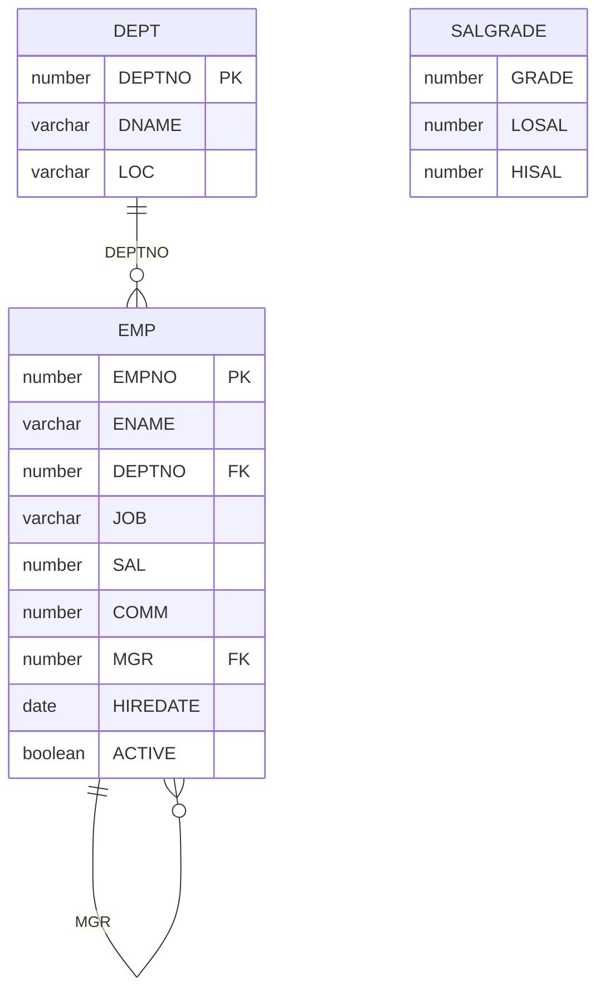

# Spring Data JPA Practice

A Spring Boot application that exercises Spring Data JPA against the classic employee schema (`EMP`, `DEPT`, `SALGRADE`) stored in a file-based H2 database. Each HTTP endpoint is one repository example: a derived query method, a JPQL or native `@Query`, a named query, a page, a custom fragment, or a CRUD call.

| Item | Value |
| --- | --- |
| Spring Boot | [1.3.1](pom.xml#L17) |
| Java | [8](pom.xml#L71) |
| Database | H2 file database, `MV_STORE=FALSE` (legacy `.h2.db` page store) |
| HTTP port | `8080` |
| Main class | [`springboot.data.jpa.DataJpaApp`](src/main/java/springboot/data/jpa/DataJpaApp.java) |
| H2 console | `http://localhost:8080/h2` |
| Schema DDL | `none` ([`spring.jpa.hibernate.ddl-auto`](src/main/resources/application.properties#L22)) |

This project uses the Spring Data 1.x API that ships with Spring Boot 1.3.1. Repository lookup by id is `findOne(id)`. A page is built with `new PageRequest(page, size)` and `new Sort(direction, property)`. Current Spring Data uses `findById`, `PageRequest.of`, and `Sort.by`.

---

## What the examples cover

| Area | Where |
| --- | --- |
| Entity mapping for `EMP`, `DEPT`, `SALGRADE` | [`model`](src/main/java/springboot/data/jpa/model) |
| Derived query methods (keywords, nested properties, order, limit) | [`EmployeeJpaRepository`](src/main/java/springboot/data/jpa/repository/EmployeeJpaRepository.java) |
| JPQL `@Query` and a native SQL `@Query` | [`EmployeeJpaRepository`](src/main/java/springboot/data/jpa/repository/EmployeeJpaRepository.java) |
| `@NamedQuery` and `@NamedNativeQuery` on `Employee` | [`Employee`](src/main/java/springboot/data/jpa/model/Employee.java) and [`EmployeeJpaRepository`](src/main/java/springboot/data/jpa/repository/EmployeeJpaRepository.java) |
| `Pageable` and `Sort` | [`EmployeeDataJpaSelectController`](src/main/java/springboot/data/jpa/controller/EmployeeDataJpaSelectController.java) |
| Custom repository fragment (`...Custom` + `...Impl`) | [`EmployeeJpaRepositoryCustom`](src/main/java/springboot/data/jpa/repository/EmployeeJpaRepositoryCustom.java), [`EmployeeJpaRepositoryImpl`](src/main/java/springboot/data/jpa/repository/EmployeeJpaRepositoryImpl.java) |
| Save, update, delete | [`save`](src/main/java/springboot/data/jpa/controller/EmployeeDataJpaSaveController.java), [`update`](src/main/java/springboot/data/jpa/controller/EmployeeDataJpaUpdateController.java), and [`delete`](src/main/java/springboot/data/jpa/controller/EmployeeDataJpaDeleteController.java) controllers |
| Spring Data REST export | [`EmployeeJpaRestRepository`](src/main/java/springboot/data/jpa/rest/EmployeeJpaRestRepository.java) |
| Routing datasource for two H2 files | [`multitenant`](src/main/java/springboot/data/jpa/multitenant) (source is commented out) |

---

## Project layout

```text
springdatajpapractice
├── pom.xml
└── src/main
    ├── java/springboot/data/jpa
    │   ├── DataJpaApp.java                         entry point, primary DataSource, ObjectMapper
    │   ├── controller
    │   │   ├── GeneralController.java              bean and hello checks
    │   │   ├── EmployeeDataJpaSelectController.java  query examples
    │   │   ├── EmployeeDataJpaSaveController.java
    │   │   ├── EmployeeDataJpaUpdateController.java
    │   │   └── EmployeeDataJpaDeleteController.java
    │   ├── model
    │   │   ├── Employee.java                       EMP, named queries
    │   │   ├── Department.java                     DEPT
    │   │   └── SalaryGrade.java                    SALGRADE (entity only, no repository)
    │   ├── repository
    │   │   ├── EmployeeJpaRepository.java          JpaRepository + query methods
    │   │   ├── EmployeeJpaRepositoryCustom.java
    │   │   └── EmployeeJpaRepositoryImpl.java
    │   ├── rest
    │   │   ├── SpringBootDataJpaRestApp.java       alternate entry point
    │   │   └── EmployeeJpaRestRepository.java      Spring Data REST
    │   └── multitenant                               commented out; see below
    └── resources
        ├── application.properties
        ├── sql/tables.sql                          schema and seed data
        ├── springDataJpa.h2.db                    primary file database
        ├── db1.h2.db                               tenant file
        ├── db2.h2.db                               tenant file
        └── tenant/db1.properties, db2.properties
```

* [pom.xml](pom.xml)
* [DataJpaApp.java](src/main/java/springboot/data/jpa/DataJpaApp.java)
* [GeneralController.java](src/main/java/springboot/data/jpa/controller/GeneralController.java)
* [EmployeeDataJpaSelectController.java](src/main/java/springboot/data/jpa/controller/EmployeeDataJpaSelectController.java)
* [EmployeeDataJpaSaveController.java](src/main/java/springboot/data/jpa/controller/EmployeeDataJpaSaveController.java)
* [EmployeeDataJpaUpdateController.java](src/main/java/springboot/data/jpa/controller/EmployeeDataJpaUpdateController.java)
* [EmployeeDataJpaDeleteController.java](src/main/java/springboot/data/jpa/controller/EmployeeDataJpaDeleteController.java)
* [Employee.java](src/main/java/springboot/data/jpa/model/Employee.java)
* [Department.java](src/main/java/springboot/data/jpa/model/Department.java)
* [SalaryGrade.java](src/main/java/springboot/data/jpa/model/SalaryGrade.java)
* [EmployeeJpaRepository.java](src/main/java/springboot/data/jpa/repository/EmployeeJpaRepository.java)
* [EmployeeJpaRepositoryCustom.java](src/main/java/springboot/data/jpa/repository/EmployeeJpaRepositoryCustom.java)
* [EmployeeJpaRepositoryImpl.java](src/main/java/springboot/data/jpa/repository/EmployeeJpaRepositoryImpl.java)
* [SpringBootDataJpaRestApp.java](src/main/java/springboot/data/jpa/rest/SpringBootDataJpaRestApp.java)
* [EmployeeJpaRestRepository.java](src/main/java/springboot/data/jpa/rest/EmployeeJpaRestRepository.java)
* [multitenant](src/main/java/springboot/data/jpa/multitenant)
* [application.properties](src/main/resources/application.properties)
* [sql/tables.sql](src/main/resources/sql/tables.sql)
* [springDataJpa.h2.db](src/main/resources/springDataJpa.h2.db)
* [db1.h2.db](src/main/resources/db1.h2.db)
* [db2.h2.db](src/main/resources/db2.h2.db)
* [tenant/db1.properties](src/main/resources/tenant/db1.properties)
* [tenant/db2.properties](src/main/resources/tenant/db2.properties)

[`DataJpaApp`](src/main/java/springboot/data/jpa/DataJpaApp.java) is a `@SpringBootApplication` with `@EnableJpaRepositories(basePackages = "springboot.data.jpa")`. That scan picks up both [`EmployeeJpaRepository`](src/main/java/springboot/data/jpa/repository/EmployeeJpaRepository.java) and [`EmployeeJpaRestRepository`](src/main/java/springboot/data/jpa/rest/EmployeeJpaRestRepository.java). The class also declares the primary `DataSource` from `spring.datasource.*` and an `ObjectMapper` bean used by [`GET /findOne`](src/main/java/springboot/data/jpa/controller/EmployeeDataJpaSelectController.java#L49).

[`spring.jpa.show-sql=true`](src/main/resources/application.properties#L19), so each request prints the SQL Hibernate ran. [`logging.level.org.springframework.web=DEBUG`](src/main/resources/application.properties#L2) prints request mapping detail.

---

## Domain

[`sql/tables.sql`](src/main/resources/sql/tables.sql) is the schema. With [`ddl-auto=none`](src/main/resources/application.properties#L22), Hibernate leaves that schema in place, and the application reads the tables already stored in the file database.



[`Employee`](src/main/java/springboot/data/jpa/model/Employee.java) maps `EMP`. The id is `EMPNO` and is assigned in code ([`@GeneratedValue` is commented out](src/main/java/springboot/data/jpa/model/Employee.java#L40)). [`Department`](src/main/java/springboot/data/jpa/model/Department.java) maps `DEPT`. Its id uses [`@GeneratedValue(strategy = GenerationType.AUTO)`](src/main/java/springboot/data/jpa/model/Department.java#L35). [`SalaryGrade`](src/main/java/springboot/data/jpa/model/SalaryGrade.java) maps `SALGRADE` with [`GRADE` as `@Id`](src/main/java/springboot/data/jpa/model/SalaryGrade.java#L25). Nothing in this project exposes `SalaryGrade` over HTTP.

Associations on the two entities:

- [`Employee.department`](src/main/java/springboot/data/jpa/model/Employee.java#L113) is `@ManyToOne` with `@JoinColumn(name = "DEPTNO")`. `@ManyToOne` is eager, so loading an employee also loads its department.
- [`Department.employees`](src/main/java/springboot/data/jpa/model/Department.java#L63) is `@OneToMany(cascade = CascadeType.ALL)` with `@JoinColumn(name = "DEPTNO")` on the same column. `@OneToMany` is lazy.
- [`Employee.manager`](src/main/java/springboot/data/jpa/model/Employee.java#L86) is the raw `MGR` number. It is a foreign key in [`sql/tables.sql`](src/main/resources/sql/tables.sql) and a plain `Integer` on the entity.

Both sides declare `@JoinColumn` on `DEPTNO`. Jackson, with Open EntityManager in View left at the Spring Boot default, will walk `Employee` → `Department` → `employees` → `Employee` and can fail with a nested mapping cycle on endpoints that return those entities. `GET /findOne` builds the JSON with the application's `ObjectMapper` and hits the same graph.

### Seed data

Departments:

| DEPTNO | DNAME | LOC |
| --- | --- | --- |
| 10 | ACCOUNTING | NEW YORK |
| 20 | RESEARCH | DALLAS |
| 30 | SALES | CHICAGO |
| 40 | OPERATIONS | BOSTON |

Employees (14 rows) from [`sql/tables.sql`](src/main/resources/sql/tables.sql). `ACTIVE` is not set by the inserts, so it stays null. [`GET /findByActiveTrue`](src/main/java/springboot/data/jpa/controller/EmployeeDataJpaSelectController.java#L212) and [`GET /findByActiveFalse`](src/main/java/springboot/data/jpa/controller/EmployeeDataJpaSelectController.java#L217) return an empty list until a row's `ACTIVE` column is updated.

| EMPNO | ENAME | JOB | MGR | HIREDATE | SAL | COMM | DEPTNO |
| --- | --- | --- | --- | --- | --- | --- | --- |
| 7839 | KING | PRESIDENT | | 17-11-1981 | 5000 | | 10 |
| 7698 | BLAKE | MANAGER | 7839 | 01-05-1981 | 2850 | | 30 |
| 7782 | CLARK | MANAGER | 7839 | 09-06-1981 | 2450 | | 10 |
| 7566 | JONES | MANAGER | 7839 | 02-04-1981 | 2975 | | 20 |
| 7654 | MARTIN | SALESMAN | 7698 | 28-09-1981 | 1250 | 1400 | 30 |
| 7499 | ALLEN | SALESMAN | 7698 | 20-02-1981 | 1600 | 300 | 30 |
| 7844 | TURNER | SALESMAN | 7698 | 08-09-1981 | 1500 | 0 | 30 |
| 7900 | JAMES | CLERK | 7698 | 03-12-1981 | 950 | | 30 |
| 7521 | WARD | SALESMAN | 7698 | 22-02-1981 | 1250 | 500 | 30 |
| 7902 | FORD | ANALYST | 7566 | 03-12-1981 | 3000 | | 20 |
| 7369 | SMITH | CLERK | 7902 | 17-12-1980 | 800 | | 20 |
| 7788 | SCOTT | ANALYST | 7566 | 09-12-1982 | 3000 | | 20 |
| 7876 | ADAMS | CLERK | 7788 | 12-01-1983 | 1100 | | 20 |
| 7934 | MILLER | CLERK | 7782 | 23-01-1982 | 1300 | | 10 |

[`SALGRADE` inserts](src/main/resources/sql/tables.sql) use the column list `(HISAL, LOSAL, GRADE)` and the value tuples `(1, 700, 1200)`, `(2, 1201, 1400)`, `(3, 1401, 2000)`, `(4, 2001, 3000)`, `(5, 3001, 9999)`. Those tuples are the classic `(grade, losal, hisal)` numbers, so grade `1` is stored in `HISAL` and `1200` is stored in `GRADE`. The [entity](src/main/java/springboot/data/jpa/model/SalaryGrade.java#L25) reads `GRADE` as the id.

Dates in the script use H2 `parsedatetime(..., 'dd-MM-yyyy')`.

---

## Run

Java 8 and Maven. From `springdatajpapractice`:

```bash
mvn spring-boot:run
```

Or run [`springboot.data.jpa.DataJpaApp`](src/main/java/springboot/data/jpa/DataJpaApp.java). The [jar manifest](pom.xml#L86) also names that class.

[`application.properties`](src/main/resources/application.properties) points the primary database at an absolute path on `E:`. Point it at the file in this module before starting. H2 adds the `.h2.db` suffix when `MV_STORE=FALSE`, so the URL has no suffix:

```properties
spring.datasource.url=jdbc:h2:file:./src/main/resources/springDataJpa;MV_STORE=FALSE
spring.datasource.username=springDataJpa
spring.datasource.password=springDataJpa
```

The working directory for that relative path is the module root (`springdatajpapractice`). A different working directory needs a path that still resolves to [`springDataJpa.h2.db`](src/main/resources/springDataJpa.h2.db).

Check that the process is up:

```bash
curl http://localhost:8080/hello
```

```text
Welcome to Spring Boot Data JPA
```

H2 console: open `http://localhost:8080/h2` and use the same JDBC URL, user, and password. `SELECT * FROM EMP` should return the seed rows.

[`SpringBootDataJpaRestApp`](src/main/java/springboot/data/jpa/rest/SpringBootDataJpaRestApp.java) is a second `main`. Its component scan is `springboot.data.jpa`, which includes [`DataJpaApp`](src/main/java/springboot/data/jpa/DataJpaApp.java), so that entry point still registers the primary `DataSource` bean and the controllers. Use [`DataJpaApp`](src/main/java/springboot/data/jpa/DataJpaApp.java) as the main to run.

---

## Configuration

| Property | Role |
| --- | --- |
| [`server.port=8080`](src/main/resources/application.properties#L5) | HTTP port. |
| [`spring.h2.console.enabled=true`](src/main/resources/application.properties#L7) | Serves the H2 console. |
| [`spring.h2.console.path=/h2`](src/main/resources/application.properties#L8) | Console path. |
| [`spring.datasource.url`](src/main/resources/application.properties#L11) | File database. `MV_STORE=FALSE` selects the `.h2.db` page store that matches the checked-in file. |
| [`spring.datasource.username`](src/main/resources/application.properties#L12) / [`password`](src/main/resources/application.properties#L13) | `springDataJpa` / `springDataJpa`. |
| [`spring.datasource.driver-class-name`](src/main/resources/application.properties#L14) | `org.h2.Driver`. |
| [`spring.jpa.database-platform`](src/main/resources/application.properties#L16) | `org.hibernate.dialect.H2Dialect`. |
| [`spring.jpa.show-sql`](src/main/resources/application.properties#L19) | Prints SQL. |
| [`spring.jpa.hibernate.ddl-auto=none`](src/main/resources/application.properties#L22) | Hibernate leaves the schema alone. Tables come from the existing file database (built from [`sql/tables.sql`](src/main/resources/sql/tables.sql)). |
| [`logging.level.org.springframework.web`](src/main/resources/application.properties#L2) | `DEBUG`. |

The [`DataSource` bean](src/main/java/springboot/data/jpa/DataJpaApp.java#L33) in [`DataJpaApp`](src/main/java/springboot/data/jpa/DataJpaApp.java) is `@Primary` and `@ConfigurationProperties(prefix = "spring.datasource")`. The comment on that method says to comment it out when switching on the multi-tenant datasource, which would otherwise be a second `DataSource` bean.

---

## Derived query methods

[`EmployeeJpaRepository`](src/main/java/springboot/data/jpa/repository/EmployeeJpaRepository.java) extends `JpaRepository<Employee, Integer>`. Spring Data turns each method name into a query. The HTTP mappings live in [`EmployeeDataJpaSelectController`](src/main/java/springboot/data/jpa/controller/EmployeeDataJpaSelectController.java).

Property names in method names are the Java fields (`name`, `job`, `salary`, `hiredate`, `active`, `manager`, `department.deptName`), which map to `ENAME`, `JOB`, `SAL`, `HIREDATE`, `ACTIVE`, `MGR`, and `DEPT.DNAME`.

### Equality, like, and count

| Method | SQL predicate | URL |
| --- | --- | --- |
| [`findByName`](src/main/java/springboot/data/jpa/repository/EmployeeJpaRepository.java#L20) | `ename = ?` | [`GET /findByName/BLAKE`](src/main/java/springboot/data/jpa/controller/EmployeeDataJpaSelectController.java#L83) |
| [`findByNameIs`](src/main/java/springboot/data/jpa/repository/EmployeeJpaRepository.java#L22) | `ename = ?` | [`GET /findByNameIs/BLAKE`](src/main/java/springboot/data/jpa/controller/EmployeeDataJpaSelectController.java#L120) |
| [`findByNameEquals`](src/main/java/springboot/data/jpa/repository/EmployeeJpaRepository.java#L24) | `ename = ?` | [`GET /findByNameEquals/BLAKE`](src/main/java/springboot/data/jpa/controller/EmployeeDataJpaSelectController.java#L125) |
| [`findByNameNot`](src/main/java/springboot/data/jpa/repository/EmployeeJpaRepository.java#L26) | `ename <> ?` | [`GET /findByNameNot/BLAKE`](src/main/java/springboot/data/jpa/controller/EmployeeDataJpaSelectController.java#L130) |
| [`findByNameLike`](src/main/java/springboot/data/jpa/repository/EmployeeJpaRepository.java#L29) | `ename like ?` | [`GET /findByNameLike?name=KI`](src/main/java/springboot/data/jpa/controller/EmployeeDataJpaSelectController.java#L98) — the controller appends `%`, so this call is `KI%` |
| [`findByNameNotLike`](src/main/java/springboot/data/jpa/repository/EmployeeJpaRepository.java#L31) | `ename not like ?` | [`GET /findByNameNotLike/KI`](src/main/java/springboot/data/jpa/controller/EmployeeDataJpaSelectController.java#L141) — controller appends `%` |
| [`countByName`](src/main/java/springboot/data/jpa/repository/EmployeeJpaRepository.java#L33) | `count` where `ename = ?` | [`GET /countByName/BLAKE`](src/main/java/springboot/data/jpa/controller/EmployeeDataJpaSelectController.java#L103) — body is `No.of Records: 1` |
| [`findByNameIgnoreCase`](src/main/java/springboot/data/jpa/repository/EmployeeJpaRepository.java#L156) | `upper(ename) = upper(?)` | [`GET /findByNameIgnoreCase/blake`](src/main/java/springboot/data/jpa/controller/EmployeeDataJpaSelectController.java#L247) |
| [`findByNameStartingWith`](src/main/java/springboot/data/jpa/repository/EmployeeJpaRepository.java#L42) | `ename like ?%` | [`GET /findByNameStartingWith/KI`](src/main/java/springboot/data/jpa/controller/EmployeeDataJpaSelectController.java#L146) |
| [`findByNameEndingWith`](src/main/java/springboot/data/jpa/repository/EmployeeJpaRepository.java#L45) | `ename like %?` | [`GET /findByNameEndingWith/NG`](src/main/java/springboot/data/jpa/controller/EmployeeDataJpaSelectController.java#L151) |
| [`findByNameContaining`](src/main/java/springboot/data/jpa/repository/EmployeeJpaRepository.java#L48) | `ename like %?%` | [`GET /findByNameContaining/AR`](src/main/java/springboot/data/jpa/controller/EmployeeDataJpaSelectController.java#L156) |
| [`findByNameStartingWithIgnoreCase`](src/main/java/springboot/data/jpa/repository/EmployeeJpaRepository.java#L163) | `upper(ename) like upper(?%)` | [`GET /findByNameStartingWithIgnoreCase/ki`](src/main/java/springboot/data/jpa/controller/EmployeeDataJpaSelectController.java#L252) |

`StartingWith`, `EndingWith`, and `Containing` add the `%` wildcards. `Like` passes the argument through unchanged, so the [controller](src/main/java/springboot/data/jpa/controller/EmployeeDataJpaSelectController.java) appends `%` on the like endpoints marked in the table.

[`GET /findOne`](src/main/java/springboot/data/jpa/controller/EmployeeDataJpaSelectController.java#L49) calls `findOne(7839)` and returns KING as a JSON string. [`GET /findAll`](src/main/java/springboot/data/jpa/controller/EmployeeDataJpaSelectController.java#L66) returns every employee.

### Combinations

| Method | SQL predicate | URL |
| --- | --- | --- |
| [`findByNameAndJob`](src/main/java/springboot/data/jpa/repository/EmployeeJpaRepository.java#L35) | `ename = ? and job = ?` | [`GET /findByNameAndJob?name=BLAKE&job=MANAGER`](src/main/java/springboot/data/jpa/controller/EmployeeDataJpaSelectController.java#L108) |
| [`findByNameOrJob`](src/main/java/springboot/data/jpa/repository/EmployeeJpaRepository.java#L37) | `ename = ? or job = ?` | [`GET /findByNameOrJob?name=BLAKE&job=CLERK`](src/main/java/springboot/data/jpa/controller/EmployeeDataJpaSelectController.java#L114) |
| [`findByNameNotAndJob`](src/main/java/springboot/data/jpa/repository/EmployeeJpaRepository.java#L39) | `ename <> ? and job = ?` | [`GET /findByNameNotAndJob?name=BLAKE&job=MANAGER`](src/main/java/springboot/data/jpa/controller/EmployeeDataJpaSelectController.java#L135) |

### Numbers, dates, booleans, nulls

| Method | SQL predicate | URL |
| --- | --- | --- |
| [`findBySalaryLessThan`](src/main/java/springboot/data/jpa/repository/EmployeeJpaRepository.java#L55) | `sal < ?` | [`GET /findBySalaryLessThan/1000`](src/main/java/springboot/data/jpa/controller/EmployeeDataJpaSelectController.java#L161) |
| [`findBySalaryLessThanEqual`](src/main/java/springboot/data/jpa/repository/EmployeeJpaRepository.java#L62) | `sal <= ?` | [`GET /findBySalaryLessThanEqual/800`](src/main/java/springboot/data/jpa/controller/EmployeeDataJpaSelectController.java#L166) |
| [`findBySalaryGreaterThan`](src/main/java/springboot/data/jpa/repository/EmployeeJpaRepository.java#L65) | `sal > ?` | [`GET /findBySalaryGreaterThan/2000`](src/main/java/springboot/data/jpa/controller/EmployeeDataJpaSelectController.java#L171) |
| [`findBySalaryGreaterThanEqual`](src/main/java/springboot/data/jpa/repository/EmployeeJpaRepository.java#L68) | `sal >= ?` | [`GET /findBySalaryGreaterThanEqual/3000`](src/main/java/springboot/data/jpa/controller/EmployeeDataJpaSelectController.java#L176) |
| [`findBySalaryGreaterThanAndSalaryLessThan`](src/main/java/springboot/data/jpa/repository/EmployeeJpaRepository.java#L75) | `sal > ? and sal < ?` | [`GET /findBySalaryGreterThanAndSalaryLessThan/1000/2000`](src/main/java/springboot/data/jpa/controller/EmployeeDataJpaSelectController.java#L181) |
| [`findByHiredateBefore`](src/main/java/springboot/data/jpa/repository/EmployeeJpaRepository.java#L82) | `hiredate < ?` | [`GET /findByHiredateBefore/1981/06/01`](src/main/java/springboot/data/jpa/controller/EmployeeDataJpaSelectController.java#L187) |
| [`findByHiredateAfter`](src/main/java/springboot/data/jpa/repository/EmployeeJpaRepository.java#L89) | `hiredate > ?` | [`GET /findByHiredateAfter/1982/01/01`](src/main/java/springboot/data/jpa/controller/EmployeeDataJpaSelectController.java#L195) |
| [`findByHiredateBetween`](src/main/java/springboot/data/jpa/repository/EmployeeJpaRepository.java#L96) | `hiredate between ? and ?` | [`GET /findByHiredateBetween/1981/01/01`](src/main/java/springboot/data/jpa/controller/EmployeeDataJpaSelectController.java#L203) |
| [`findByActiveTrue`](src/main/java/springboot/data/jpa/repository/EmployeeJpaRepository.java#L103) | `active = true` | [`GET /findByActiveTrue`](src/main/java/springboot/data/jpa/controller/EmployeeDataJpaSelectController.java#L212) |
| [`findByActiveFalse`](src/main/java/springboot/data/jpa/repository/EmployeeJpaRepository.java#L110) | `active = false` | [`GET /findByActiveFalse`](src/main/java/springboot/data/jpa/controller/EmployeeDataJpaSelectController.java#L217) |
| [`findByManagerIsNull`](src/main/java/springboot/data/jpa/repository/EmployeeJpaRepository.java#L117) | `mgr is null` | [`GET /findByManagerIsNull`](src/main/java/springboot/data/jpa/controller/EmployeeDataJpaSelectController.java#L222) — KING |
| [`findByManagerIsNotNull`](src/main/java/springboot/data/jpa/repository/EmployeeJpaRepository.java#L124) | `mgr is not null` | [`GET /findByManagerIsNotNull`](src/main/java/springboot/data/jpa/controller/EmployeeDataJpaSelectController.java#L227) |
| [`findByManagerNotNull`](src/main/java/springboot/data/jpa/repository/EmployeeJpaRepository.java#L131) | `mgr is not null` | [`GET /findByManagerNotNull`](src/main/java/springboot/data/jpa/controller/EmployeeDataJpaSelectController.java#L232) |

The salary-between path is spelled `Greter` in the [controller](src/main/java/springboot/data/jpa/controller/EmployeeDataJpaSelectController.java#L181). That spelling is the URL.

Hire-date paths take `year`, `month`, and `day` as integers and build a `java.util.Date` at the start of that day in the JVM default zone. `findByHiredateBetween` uses that date as the start and **today** as the end.

`IsNull` / `IsNotNull` and `NotNull` are the same null check. The repository includes both forms.

### Nested property, order, and limit

`DepartmentDeptName` traverses `employee.department.deptName` and joins `DEPT`.

| Method | SQL shape | URL |
| --- | --- | --- |
| [`findByDepartmentDeptNameIn`](src/main/java/springboot/data/jpa/repository/EmployeeJpaRepository.java#L140) | `dname in (?)` | [`GET /findByDepartmentDeptNameIn/SALES`](src/main/java/springboot/data/jpa/controller/EmployeeDataJpaSelectController.java#L237) |
| [`findByDepartmentDeptNameNotIn`](src/main/java/springboot/data/jpa/repository/EmployeeJpaRepository.java#L149) | `dname not in (?)` | [`GET /findByDepartmentDeptNameNotIn/SALES`](src/main/java/springboot/data/jpa/controller/EmployeeDataJpaSelectController.java#L242) |
| [`findByJobOrderBySalaryAsc`](src/main/java/springboot/data/jpa/repository/EmployeeJpaRepository.java#L170) | `job = ? order by sal asc` | [`GET /findByJobOrderBySalaryAsc/CLERK`](src/main/java/springboot/data/jpa/controller/EmployeeDataJpaSelectController.java#L257) |
| [`findByJobOrderBySalaryDesc`](src/main/java/springboot/data/jpa/repository/EmployeeJpaRepository.java#L177) | `job = ? order by sal desc` | [`GET /findByJobOrderBySalaryDesc/MANAGER`](src/main/java/springboot/data/jpa/controller/EmployeeDataJpaSelectController.java#L262) |
| [`findFirstByNameLike`](src/main/java/springboot/data/jpa/repository/EmployeeJpaRepository.java#L184) | `ename like ?` limit 1 | [`GET /findFirstByNameLike/S`](src/main/java/springboot/data/jpa/controller/EmployeeDataJpaSelectController.java#L267) — controller appends `%` |
| [`findTop5ByNameLike`](src/main/java/springboot/data/jpa/repository/EmployeeJpaRepository.java#L191) | `ename like ?` limit 5 | [`GET /findTop5ByNameLike/S`](src/main/java/springboot/data/jpa/controller/EmployeeDataJpaSelectController.java#L272) — controller appends `%` |
| [`findTop1ByDepartmentDeptNameOrderByHiredateDescNameAsc`](src/main/java/springboot/data/jpa/repository/EmployeeJpaRepository.java#L264) | `dname = ? order by hiredate desc, ename asc` limit 1 | [`GET /findByDeptNameOrderByHireDateAndName?deptName=RESEARCH`](src/main/java/springboot/data/jpa/controller/EmployeeDataJpaSelectController.java#L336) |

`In` / `NotIn` take a `List`. The [controller](src/main/java/springboot/data/jpa/controller/EmployeeDataJpaSelectController.java#L237) wraps the single path variable in `Arrays.asList`.

`First` and `Top5` are Spring Data limit keywords. `Top1` plus `OrderByHiredateDescNameAsc` returns the employee in that department with the latest hire date, using `name` ascending as the tie-break.

---

## `@Query`, named queries, and pages

### JPQL and native SQL

| Method | Query | URL |
| --- | --- | --- |
| [`queryByName`](src/main/java/springboot/data/jpa/repository/EmployeeJpaRepository.java#L199) | `select e from Employee e where e.name = :inputName` | [`GET /queryByName/KING`](src/main/java/springboot/data/jpa/controller/EmployeeDataJpaSelectController.java#L277) |
| [`queryBySalaryGreaterThan`](src/main/java/springboot/data/jpa/repository/EmployeeJpaRepository.java#L207) | `from Employee e where e.salary > :sal` | [`GET /queryBySalaryGreaterThan/2000`](src/main/java/springboot/data/jpa/controller/EmployeeDataJpaSelectController.java#L282) |
| [`queryBySQLName`](src/main/java/springboot/data/jpa/repository/EmployeeJpaRepository.java#L213) | `select * from emp where ename = :inputName` (`nativeQuery = true`) | [`GET /queryBySQLName/KING`](src/main/java/springboot/data/jpa/controller/EmployeeDataJpaSelectController.java#L287) |

### Named queries

Declared on [`Employee`](src/main/java/springboot/data/jpa/model/Employee.java):

- [`@NamedQuery(name = "Employee.namedFindByDeptName")`](src/main/java/springboot/data/jpa/model/Employee.java#L8) — JPQL `select e from Employee e where e.department.deptName = :inputDeptName`. Spring Data matches a named query whose name is `{entity}.{name}`.
- [`@NamedNativeQuery(name = "Employee.namedNativeFindByName")`](src/main/java/springboot/data/jpa/model/Employee.java#L10) — `select * from emp where ename = :inputName`.

Repository methods bind them with `@Query(name = "...")`:

| Method | URL |
| --- | --- |
| [`namedQueryFindByDeptName`](src/main/java/springboot/data/jpa/repository/EmployeeJpaRepository.java#L226) | [`GET /namedQueryFindByDeptName/SALES`](src/main/java/springboot/data/jpa/controller/EmployeeDataJpaSelectController.java#L292) |
| [`namedNativeQueryByName`](src/main/java/springboot/data/jpa/repository/EmployeeJpaRepository.java#L232) | [`GET /namedNativeQueryByName/KING`](src/main/java/springboot/data/jpa/controller/EmployeeDataJpaSelectController.java#L297) |

The [native named query](src/main/java/springboot/data/jpa/model/Employee.java#L10) has no `resultClass = Employee.class`. A native query that should return `Employee` entities needs that attribute (or a `@SqlResultSetMapping`) so the provider maps columns onto the entity.

### Pages

Both methods reuse `from Employee e where e.salary > :sal` and accept a `Pageable`.

| URL | Page request |
| --- | --- |
| [`GET /queryBySalaryGreaterThanWithPageable/1000`](src/main/java/springboot/data/jpa/controller/EmployeeDataJpaSelectController.java#L302) | page `0`, size `3` ([repository method](src/main/java/springboot/data/jpa/repository/EmployeeJpaRepository.java#L240)) |
| [`GET /queryBySalaryGreaterThanWithPageableSort/1000`](src/main/java/springboot/data/jpa/controller/EmployeeDataJpaSelectController.java#L321) | page `0`, size `3`, sort `name` ascending ([repository method](src/main/java/springboot/data/jpa/repository/EmployeeJpaRepository.java#L251)) |

Page index `0` is the first page. The unsorted endpoint prints `totalElements`, `size`, and `totalPages` to the console. The HTTP body is the `Page` (the employee slice plus those counts). Sort property `name` is the entity property, so the SQL orders by `ENAME`.

---

## Custom repository fragment

[`EmployeeJpaRepository`](src/main/java/springboot/data/jpa/repository/EmployeeJpaRepository.java) also extends [`EmployeeJpaRepositoryCustom`](src/main/java/springboot/data/jpa/repository/EmployeeJpaRepositoryCustom.java). Spring Data looks for a class named [`EmployeeJpaRepositoryImpl`](src/main/java/springboot/data/jpa/repository/EmployeeJpaRepositoryImpl.java) (the default `Impl` postfix) in the same package, constructs it, and wires it in.

```java
public String customMethod() {
    return "Custom method";
}
```

```bash
curl http://localhost:8080/customMethod
```

The response body is the JSON string `"Custom method"`.

---

## Save, update, delete

Ids are application-assigned. Seed employee numbers are in the 7000s, so a new row can use a small id such as `1`. `DEPTNO` is nullable, and these save calls leave `department` null.

| URL | Behavior |
| --- | --- |
| [`GET /saveOne`](src/main/java/springboot/data/jpa/controller/EmployeeDataJpaSaveController.java#L24) | Saves employee `1`, name `testName1`, job `testJob1`, salary `65432`, hire date now. |
| [`GET /save/{id}/{name}`](src/main/java/springboot/data/jpa/controller/EmployeeDataJpaSaveController.java#L36) | Same defaults, with the id and name from the path. Example: `GET /save/2/Ada`. |
| [`POST /updateOne`](src/main/java/springboot/data/jpa/controller/EmployeeDataJpaUpdateController.java#L23) | Body is an `Employee` JSON document. `saveAndFlush` inserts or updates by `EMPNO`. |
| [`POST /updateByName/{oldName}/{newName}`](src/main/java/springboot/data/jpa/controller/EmployeeDataJpaUpdateController.java#L28) | Bulk JPQL `update Employee e set e.name = :newName where e.name = :oldName`. Returns the row count. Example: `POST /updateByName/SMITH/SMYTHE`. |
| [`GET /delete/{id}`](src/main/java/springboot/data/jpa/controller/EmployeeDataJpaDeleteController.java#L22) | `findOne` then `delete`. Body is `success`, or `failed` when the id is missing. |

[`updateByName`](src/main/java/springboot/data/jpa/repository/EmployeeJpaRepository.java#L220) is `@Modifying` on the repository. The repository interface is `@Transactional`, which is what allows the bulk update to run.

`POST /updateOne` consumes `application/json`. A minimal body that updates KING's job:

```json
{"id": 7839, "name": "KING", "job": "PRESIDENT", "salary": 5000}
```

Sending a partial document overwrites unmapped columns with null, because `save` writes the entity state. Load the row, change the field, and post the full object when the other columns must stay.

---

## Bean check endpoints

[`GeneralController`](src/main/java/springboot/data/jpa/controller/GeneralController.java) prints the live beans. Responses are plain text.

| URL | Shows |
| --- | --- |
| [`GET /hello`](src/main/java/springboot/data/jpa/controller/GeneralController.java#L38) | Fixed welcome string. |
| [`GET /primaryDataSource`](src/main/java/springboot/data/jpa/controller/GeneralController.java#L43) | The `@Primary` `DataSource`. |
| [`GET /entityManager`](src/main/java/springboot/data/jpa/controller/GeneralController.java#L48) | The JPA `EntityManager`. |
| [`GET /objectMapper`](src/main/java/springboot/data/jpa/controller/GeneralController.java#L53) | The `ObjectMapper` bean from [`DataJpaApp`](src/main/java/springboot/data/jpa/DataJpaApp.java#L39). |
| [`GET /employeeJpaRepository`](src/main/java/springboot/data/jpa/controller/GeneralController.java#L58) | The Spring Data repository proxy. |

---

## Spring Data REST

`spring-boot-starter-data-rest` is on the classpath. Spring Data REST exports public repository interfaces.

[`EmployeeJpaRestRepository`](src/main/java/springboot/data/jpa/rest/EmployeeJpaRestRepository.java) extends `PagingAndSortingRepository<Employee, Integer>` and is annotated:

```java
@RepositoryRestResource(collectionResourceRel = "employees", path = "/employeesList")
```

| URL | What it is |
| --- | --- |
| `GET /employeesList` | Collection. HAL document, default page size 20. |
| `GET /employeesList/7839` | One employee. |
| `GET /employeesList/search` | Index of search methods on this interface. |
| `GET /employeesList/search/findByName?name=BLAKE` | [`findByName`](src/main/java/springboot/data/jpa/rest/EmployeeJpaRestRepository.java#L14). Spring Data REST binds `name` from the query string. |
| `POST /employeesList` | Create. Send a JSON body. |
| `PUT /employeesList/7839` | Replace. |
| `DELETE /employeesList/7839` | Delete. |

[`EmployeeJpaRepository`](src/main/java/springboot/data/jpa/repository/EmployeeJpaRepository.java) is also a public Spring Data repository, so it is exported at the default path for the entity, `/employees`, with a `/employees/search` index of its query methods. The MVC controllers stay on the paths in the tables above (`/findByName/...`, `/queryByName/...`, and the rest). Those paths are separate from the REST repository resources.

Responses use HAL (`application/hal+json`) and include `_links`.

---

## Multi-tenant datasource

The classes under [`multitenant`](src/main/java/springboot/data/jpa/multitenant) are commented out, and so is [`GET /multiTenant`](src/main/java/springboot/data/jpa/controller/EmployeeDataJpaSaveController.java#L49) on the save controller. The design, as written in that source, is an `AbstractRoutingDataSource`:

1. [`TenantContext`](src/main/java/springboot/data/jpa/multitenant/TenantContext.java) holds the current tenant id in a `ThreadLocal`.
2. [`MultiTenantDataSource.determineCurrentLookupKey()`](src/main/java/springboot/data/jpa/multitenant/MultiTenantDataSource.java#L10) returns that id.
3. [`MultiTenantConfiguration`](src/main/java/springboot/data/jpa/multitenant/MultiTenantConfiguration.java) reads every properties file in the tenant directory, builds a `DataSource` per file, and registers it under the file's `name` property. [`db1.properties`](src/main/resources/tenant/db1.properties) → tenant `db1`. [`db2.properties`](src/main/resources/tenant/db2.properties) → tenant `db2`. The default target is the primary `spring.datasource` when the lookup key is empty.
4. The commented controller method reads header `X-TenantID`, calls `TenantContext.setCurrentTenant`, then `save`s an employee. The insert goes to the database selected by that header.

Tenant files in this module:

| File | `name` | User |
| --- | --- | --- |
| [`tenant/db1.properties`](src/main/resources/tenant/db1.properties) | `db1` | `db1` / `db1` |
| [`tenant/db2.properties`](src/main/resources/tenant/db2.properties) | `db2` | `db2` / `db2` |

Their JDBC URLs are absolute `E:` paths, same as the primary URL. The matching files in this module are [`src/main/resources/db1.h2.db`](src/main/resources/db1.h2.db) and [`db2.h2.db`](src/main/resources/db2.h2.db). A local URL has the same shape as the primary one, for example `jdbc:h2:file:./src/main/resources/db1;MV_STORE=FALSE`. The configuration loads tenant files from a hardcoded directory (`...\resources\tenant`). Point that directory at this module's [`src/main/resources/tenant`](src/main/resources/tenant) when you enable the example.

The source comments describe how the pieces fit together when the example is turned on:

- Comment out [`DataJpaApp.dataSource()`](src/main/java/springboot/data/jpa/DataJpaApp.java#L33) so only the routing `DataSource` is defined.
- Uncomment [`MultiTenantConfiguration`](src/main/java/springboot/data/jpa/multitenant/MultiTenantConfiguration.java), [`MultiTenantDataSource`](src/main/java/springboot/data/jpa/multitenant/MultiTenantDataSource.java), and [`TenantContext`](src/main/java/springboot/data/jpa/multitenant/TenantContext.java).
- Uncomment [`multiTenant`](src/main/java/springboot/data/jpa/controller/EmployeeDataJpaSaveController.java#L49) on [`EmployeeDataJpaSaveController`](src/main/java/springboot/data/jpa/controller/EmployeeDataJpaSaveController.java).
- Comment the injections in [`GeneralController`](src/main/java/springboot/data/jpa/controller/GeneralController.java). That controller requires `@Qualifier("primaryDataSource")`, and the routing `DataSource` bean does not carry that qualifier.

```bash
curl -H "X-TenantID: db1" http://localhost:8080/multiTenant
```

---

## Failure cases

| Symptom | Likely cause |
| --- | --- |
| Database file not found, or an empty schema | [`spring.datasource.url`](src/main/resources/application.properties#L11) still points at the `E:` path. Point it at [`springDataJpa.h2.db`](src/main/resources/springDataJpa.h2.db) in this module. |
| `Table "EMP" not found` | The URL opened a new empty file, or `MV_STORE` does not match the `.h2.db` file. Keep `MV_STORE=FALSE`. |
| Port `8080` already in use | Another process holds [`server.port`](src/main/resources/application.properties#L5). |
| JSON mapping error about a nested [`Employee`](src/main/java/springboot/data/jpa/model/Employee.java) / [`Department`](src/main/java/springboot/data/jpa/model/Department.java) | Bidirectional association serialized with both sides loaded. |
| [`GET /findByActiveTrue`](src/main/java/springboot/data/jpa/controller/EmployeeDataJpaSelectController.java#L212) returns `[]` | Seed rows in [`sql/tables.sql`](src/main/resources/sql/tables.sql) leave `ACTIVE` null. |
| [`GET /namedNativeQueryByName/...`](src/main/java/springboot/data/jpa/controller/EmployeeDataJpaSelectController.java#L297) fails to build `Employee` instances | [`@NamedNativeQuery`](src/main/java/springboot/data/jpa/model/Employee.java#L10) has no `resultClass`. |
| [`GET /delete/{id}`](src/main/java/springboot/data/jpa/controller/EmployeeDataJpaDeleteController.java#L22) returns `failed` | No row with that `EMPNO`. `findOne` returns null and `delete` throws. |
| Two `DataSource` beans after uncommenting multi-tenant | [`DataJpaApp.dataSource()`](src/main/java/springboot/data/jpa/DataJpaApp.java#L33) is still active. Comment it out, as that method's comment says. |
