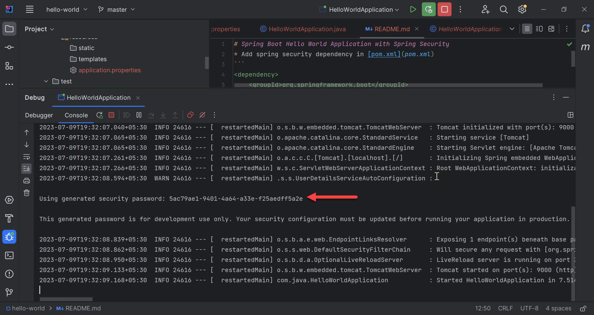
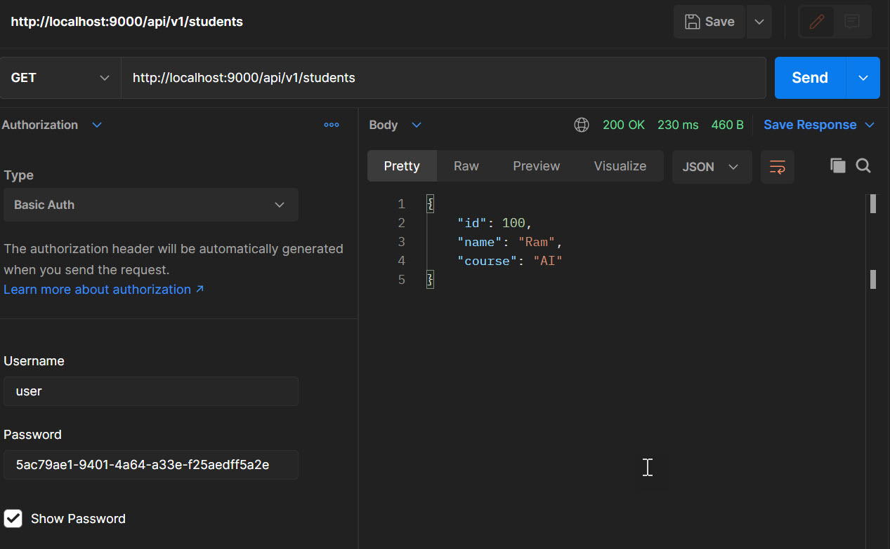

# Hello World

Spring Boot application that secures one JSON endpoint with the generated Spring Security user. There is no `UserDetailsService` and no username in `application.properties`.

`GET /api/v1/students` returns one student. A browser shows the default login form. HTTP clients can send Basic authentication.

Spring Boot 3.1.1. Java 17.

## Prerequisites

- Java 17
- Maven 3.6+

## Run

From this directory:

```bash
mvn spring-boot:run
```

The main class is [`com.java.HelloWorldApplication`](src/main/java/com/java/HelloWorldApplication.java). The process listens on port `9000`.

The console prints a new password on every start:

```text
Using generated security password: <password>
```



## Call the API

Username `user`. Password is the value from that console line.

```bash
curl -u user:<password> http://localhost:9000/api/v1/students
```

The response body is:

```json
{"id":100,"name":"Ram","course":"AI"}
```



The same request is in [`postman/hello-world.postman_collection.json`](postman/hello-world.postman_collection.json). The password stored in that file is from one earlier run. Use the password printed by the process you just started.

[`AppController`](src/main/java/com/java/controller/AppController.java) maps `GET /api/v1/students` and produces `application/json`.

## Configuration

| Property | Value | Purpose |
| --- | --- | --- |
| `server.port` | `9000` | HTTP port |

Values are in [`src/main/resources/application.properties`](src/main/resources/application.properties).

`pom.xml` depends on `spring-boot-starter-security`, `spring-boot-starter-web`, and `spring-boot-starter-actuator`.

## Layout

```text
src/main/java/com/java
├── HelloWorldApplication.java     Entry point
└── controller/AppController.java  GET /api/v1/students
```

## References

* [Spring Boot 3.1: Security](https://docs.spring.io/spring-boot/docs/3.1.1/reference/htmlsingle/#web.security)
