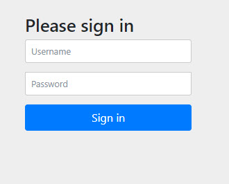

# Spring Security Generated Credentials

Spring Boot application that adds Spring Security and leaves the user unconfigured. On startup Spring Security creates the user `user` and prints a new random password.

`GET /status` returns the text `UP`. Every request requires authentication. A browser shows the default login form. HTTP clients can send Basic authentication.

Spring Boot 3.3.1. Java 17.

## Prerequisites

- Java 17
- Maven 3.6+

## Run

From this directory:

```bash
mvn spring-boot:run
```

The main class is [`com.java.Main`](src/main/java/com/java/Main.java). The process listens on port `9000`.

The console prints a line like this. The password changes on every start:

```text
Using generated security password: <password>
```

## Call the API

Username `user`. Password is the value from that console line.

```bash
curl -u user:<password> http://localhost:9000/status
```

The response body is `UP`.

Open [http://localhost:9000/status](http://localhost:9000/status) in a browser to see the login form.



The same request is in [`postman/spring-security-generated-credentials.postman_collection.json`](postman/spring-security-generated-credentials.postman_collection.json). Replace the password with the one from the current console.

[`AppController`](src/main/java/com/java/controller/AppController.java) maps `GET /status` and produces `text/plain`.

## Configuration

[`src/main/resources/application.properties`](src/main/resources/application.properties) sets the port and the application name. It does not set `spring.security.user.name` or `spring.security.user.password`, so the generated user stays in place.

| Property | Value | Purpose |
| --- | --- | --- |
| `server.port` | `9000` | HTTP port |
| `spring.application.name` | `spring-security-generated-credentials` | Application name |

`pom.xml` depends on `spring-boot-starter-security` and `spring-boot-starter-web`.

## Layout

```text
src/main/java/com/java
├── Main.java                      Entry point
└── controller/AppController.java  GET /status
```

## References

* [Spring Boot 3.3: Security](https://docs.spring.io/spring-boot/3.3/reference/web/spring-security.html)
