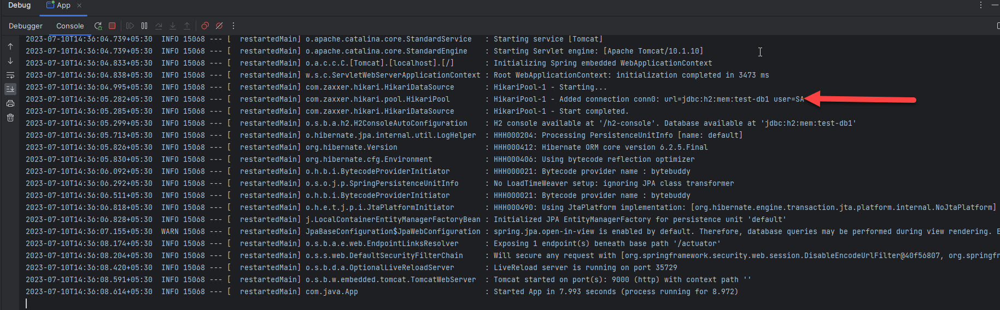
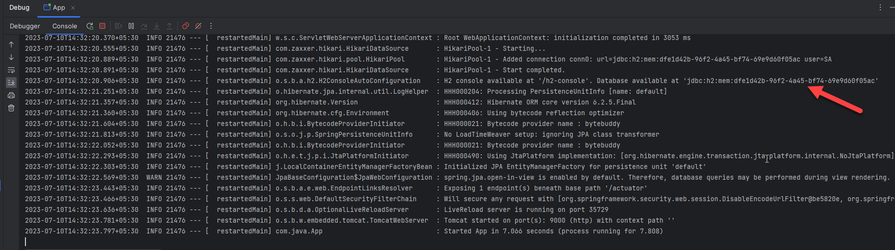

# With H2 DB

Spring Boot application that serves the H2 console behind Spring Security. There is no REST controller. The web users live in memory. The database is an in-memory H2 database.

[`SecurityConfig`](src/main/java/com/java/config/SecurityConfig.java) requires authentication for every request and enables form login. It turns off CSRF and frame options. The H2 console posts a login form and renders that form inside a frame. With the defaults still on, that page is blocked.

Spring Boot DevTools is on the classpath, so a run from the IDE or `mvn spring-boot:run` enables the console at `/h2-console`.

Spring Boot 3.1.1. Java 17.

## Prerequisites

- Java 17
- Maven 3.6+

## Run

From this directory:

```bash
mvn spring-boot:run
```

The main class is [`com.java.App`](src/main/java/com/java/App.java). The process listens on port `9000`.

Startup logs a line `H2 console available at '/h2-console'. Database available at 'jdbc:h2:mem:test-db1'`.



[`application.properties`](src/main/resources/application.properties) sets `spring.datasource.url=jdbc:h2:mem:test-db1`, so that JDBC URL stays the same across restarts. Without that property the log shows a new random database name on each start, as in this earlier run:



## Open the console

Web login, defined in [`SecurityConfig`](src/main/java/com/java/config/SecurityConfig.java):

| Username | Password | Roles |
| --- | --- | --- |
| `user1` | `pwd1` | `USER`, `ADMIN` |
| `user2` | `pwd2` | `USER`, `ADMIN` |

1. Open [http://localhost:9000/h2-console](http://localhost:9000/h2-console).
2. Sign in with `user1` / `pwd1` or `user2` / `pwd2`.
3. On the H2 login form use JDBC URL `jdbc:h2:mem:test-db1`, username `SA`, and an empty password.

The Hikari log line includes `user=SA`. That is the database user. It is separate from `user1` and `user2`.

`filterChain` is what makes step 3 reachable:

* `csrf().disable()` lets the H2 console form POST through.
* `headers().frameOptions().disable()` lets the console render inside its frame.

Passwords for `user1` and `user2` are hashed with `BCryptPasswordEncoder` before they are stored.

## Configuration

| Property | Value | Purpose |
| --- | --- | --- |
| `server.port` | `9000` | HTTP port |
| `spring.datasource.url` | `jdbc:h2:mem:test-db1` | Fixed in-memory database name |

`pom.xml` depends on `spring-boot-starter-security`, `spring-boot-starter-web`, `spring-boot-starter-data-jpa`, `spring-boot-starter-actuator`, `h2`, and `spring-boot-devtools`.

## Layout

```text
src/main/java/com/java
├── App.java                    Entry point
└── config/SecurityConfig.java  In-memory web users and the filter chain for the H2 console
```

## References

* [Spring Boot 3.1: H2 console](https://docs.spring.io/spring-boot/docs/3.1.1/reference/htmlsingle/#data.sql.h2-web-console)
* [Spring Boot 3.1: Security](https://docs.spring.io/spring-boot/docs/3.1.1/reference/htmlsingle/#web.security)
